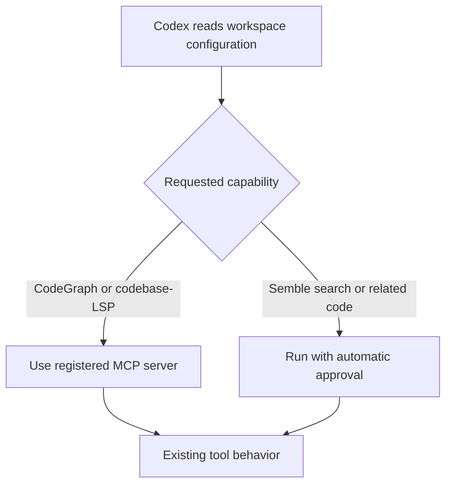

# Feature Specification: Codebase MCP Registration

**Feature Branch**: `050-codebase-mcp-registration`
**Created**: 2026-11-22
**Status**: Draft
**Input**: User description: "Register CodeGraph and codebase-LSP MCP servers in Codex configuration, set Semble search and find_related to automatic approval, and update the language guidance wording. Preserve all other main configuration."

## One-Line Purpose *(mandatory)*

Codex agents can access the repository's CodeGraph and codebase-LSP capabilities while Semble discovery calls run without individual approval prompts.

## Consumer & Context *(mandatory)*

Codex agents and repository maintainers consume the workspace-level MCP configuration during local coding sessions.

## User Scenarios & Testing *(mandatory)*

### User Story 1 - Use registered code intelligence (Priority: P1)

An agent starts a coding session and can invoke the configured CodeGraph and codebase-LSP servers.

**Why this priority**: These registrations make the existing repository tools available to the agent.

**Independent Test**: Parse the configuration and assert that both server registrations have their intended commands and working directory.

**Acceptance Scenarios**:

1. **Given** a repository checkout, **When** Codex reads `.codex/config.toml`, **Then** it finds CodeGraph and codebase-LSP registrations rooted at the repository.
2. **Given** the codebase-LSP registration, **When** its diagnostic tool is invoked, **Then** Codex requests approval before execution.

---

### User Story 2 - Search without repeated approval (Priority: P2)

An agent researching the codebase can call Semble search and related-code discovery without a per-call approval prompt.

**Why this priority**: These read-only discovery calls are routine during repository work.

**Independent Test**: Parse the configuration and assert that both Semble tool approvals are `auto`.

**Acceptance Scenarios**:

1. **Given** the Semble registration, **When** an agent calls `search` or `find_related`, **Then** the tool approval mode is `auto`.

---

### User Story 3 - Follow accurate language guidance (Priority: P3)

A maintainer reading the repository instructions sees guidance that permits CodeGraph-compatible languages while preferring common choices such as Python.

**Why this priority**: The wording keeps the instructions accurate without changing the no-shell-script policy.

**Independent Test**: Inspect the technology-choice instruction and confirm the Python preference and shell-script prohibition.

**Acceptance Scenarios**:

1. **Given** the repository instructions, **When** a maintainer reads the technology section, **Then** it prefers common CodeGraph-compatible languages and disallows Bash or other direct shell scripting languages.

### Edge Cases

- A malformed TOML edit must be rejected by configuration parsing.
- Existing MCP registrations and unrelated configuration values must remain unchanged.

## Flowchart *(mandatory)*

## Data & State Preconditions *(mandatory)*

- The repository checkout includes `.codex/config.toml` and `AGENTS.md`.
- Existing CodeGraph and codebase-LSP commands remain available through the project environment.

## Inputs & Outputs *(mandatory)*

| Direction | Description | Format |
| :-- | :-- | :-- |
| Input | Approved MCP registration and approval-mode requirements | Caller-defined |
| Output | Parsed workspace configuration exposing the requested tools | Caller-defined |

## Constraints & Non-Goals *(mandatory)*

**Must NOT**:
- Must NOT alter unrelated Codex configuration values.
- Must NOT change the behavior of either MCP server.

**Adopted dependencies**:
- CodeGraphContext and codebase-LSP: existing repository MCP servers whose registrations are configured and verified.

**Out of scope**:
- Target-repository abstraction or plugin packaging.
- Changes to Claude configuration.

## Requirements *(mandatory)*

### Functional Requirements

- **FR-001**: The system MUST register CodeGraph with the existing `uv run cgc mcp start` command and repository working directory.
- **FR-002**: The system MUST register codebase-LSP with the existing `uv run python -m mcp_codebase` command and repository working directory.
- **FR-003**: The codebase-LSP diagnostics tool MUST retain `approve` mode.
- **FR-004**: Semble `search` and `find_related` MUST use `auto` approval mode.
- **FR-005**: The change MUST preserve all unrelated `.codex/config.toml` settings.
- **FR-006**: The technology guidance MUST prefer common CodeGraph-compatible languages, including Python, and continue disallowing direct shell scripting languages.

### Key Entities

- **MCP registration**: A named Codex server configuration with its command, arguments, and working directory.
- **Tool approval mode**: The policy controlling whether a registered tool invocation proceeds automatically or requires approval.

## Success Criteria *(mandatory)*

### Measurable Outcomes

- **SC-001**: TOML parsing succeeds for the updated workspace configuration.
- **SC-002**: Configuration assertions find both new MCP registrations and their expected commands.
- **SC-003**: Configuration assertions find `auto` approval for both Semble discovery tools and `approve` for codebase-LSP diagnostics.
- **SC-004**: The scoped diff changes only the requested registrations, approval settings, and guidance wording.

## Definition of Done *(mandatory)*

In production coding workspaces, Codex can use the registered CodeGraph and codebase-LSP services while Semble discovery calls run automatically and all unrelated configuration is unchanged.

## Open Questions *(include if any unresolved decisions exist)*

- None.
