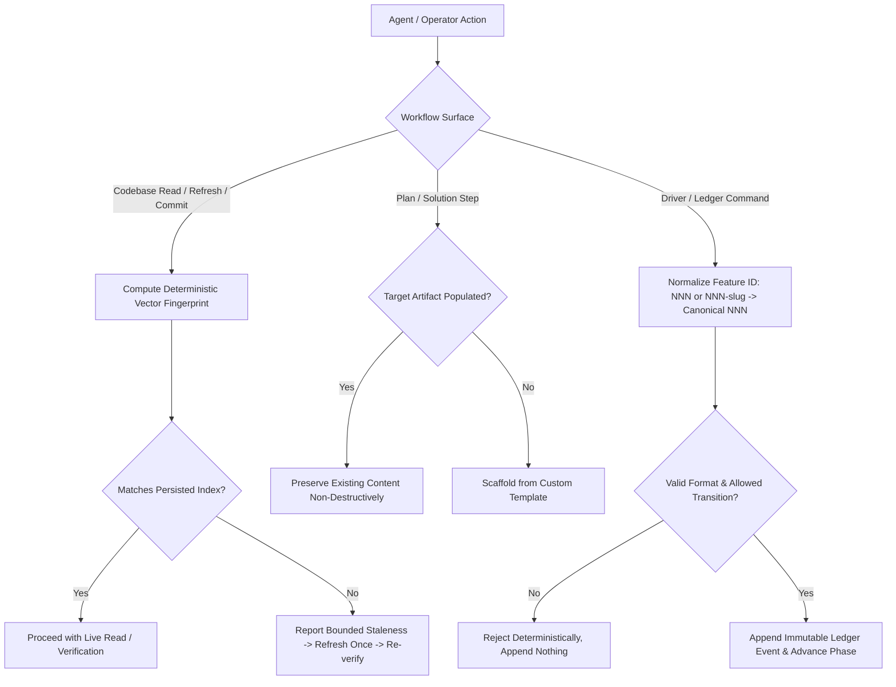

# Feature Specification: Workflow State Consistency

**Feature Branch**: `059-workflow-state-consistency`
**Created**: 2026-11-27
**Status**: Draft
**Input**: User description: "Fix recurring workflow state inconsistencies: make vector edit fingerprinting deterministic and unsurprising across reads, refreshes, commits, and verification; remove blank-template generation and destructive overwrite behavior from Plan apply-strategy and Solution task creation so existing populated artifacts are preserved; make pipeline ledger commands and driver accept either numeric feature IDs or full feature slugs and normalize them consistently. Also specify and resolve the estimate command versus ledger transition-contract misalignment. Preserve custom templates and workflow steps, maintain append-only audit integrity, add live-backend verification for index and read-code paths, and document migration/compatibility behavior. Persistent warmed-reranker ownership is specified separately by feature 061."

## One-Line Purpose *(mandatory)*

Repository operators and coding agents run Speckit reads, plans, estimates, tasking, and ledger transitions without encountering spurious staleness drift, destructive artifact overwrites, feature-ID format rejections, or estimate-to-ledger contract mismatches.

## Consumer & Context *(mandatory)*

Human maintainers and coding agents consume deterministic workflow state, preserved spec/plan/task artifacts, normalized ledger transitions, and live-verified index/read-code behavior during local CLI and Speckit pipeline execution in this repository.

## User Scenarios & Testing *(mandatory)*

### User Story 1 - Deterministic Vector Edit Fingerprinting Across Reads, Refreshes, Commits, and Verification (Priority: P1)

A maintainer or agent edits files, refreshes the codebase index, commits changes, and runs read-code or verification commands without hitting surprise stale-index errors or non-deterministic fingerprint mismatches.

**Why this priority**: Unpredictable fingerprint drift blocks codebase discovery, forces repeated refreshes, and breaks verification loops even after an index refresh has just succeeded.

**Independent Test**: Edit tracked files, run the index refresh flow, commit, and execute live read-code and verification checks; confirm the computed vector edit fingerprint matches identically across read, refresh, commit, and verification boundaries.

**Acceptance Scenarios**:

1. **Given** a clean or edited working tree that has been refreshed via the repo index refresh path, **When** read-code or freshness verification inspects the vector edit fingerprint, **Then** the fingerprint matches the refreshed state with zero false-positive stale detections.
2. **Given** an index refresh followed by a git commit of those same file contents, **When** subsequent read-code or verification checks run, **Then** the fingerprint remains consistent and does not flag unchanged committed content as stale.
3. **Given** a real file modification after refresh, **When** read-code freshness verification runs, **Then** the fingerprint deterministically detects staleness and reports a bounded, actionable refresh reason.

---

### User Story 2 - Non-Destructive Plan Apply-Strategy and Solution Task Creation (Priority: P1)

An operator or agent runs Plan apply-strategy or Solution task creation on a feature that already has populated `plan.md`, `tasks.md`, or custom workflow artifacts, and existing populated content is preserved rather than overwritten with blank templates.

**Why this priority**: Destructive blank-template overwrites erase hours of planning and tasking work and corrupt downstream gates.

**Independent Test**: Populate `plan.md` and `tasks.md` with real feature content, invoke Plan apply-strategy and Solution task creation, and verify existing populated artifacts are preserved intact while custom templates and workflow steps remain honored.

**Acceptance Scenarios**:

1. **Given** a feature directory with an already populated `plan.md`, **When** Plan apply-strategy runs, **Then** it does not generate a blank template or destructively overwrite the populated `plan.md`.
2. **Given** a feature directory with an already populated `tasks.md`, **When** Solution task creation runs, **Then** it preserves existing populated task content instead of overwriting it with an empty or blank template.
3. **Given** a feature directory where a required artifact does not yet exist or is explicitly empty, **When** Plan or Solution scaffolding runs, **Then** it initializes from the repository's configured custom templates without disturbing existing populated sibling artifacts or custom workflow steps.

---

### User Story 3 - Consistent Feature ID Normalization Across Pipeline Driver and Ledger Commands (Priority: P1)

An operator or agent passes either a numeric feature ID (e.g., `059`) or a full feature slug (e.g., `059-workflow-state-consistency`) to `pipeline_driver.py` and `pipeline_ledger.py` commands, and both accept and normalize the identifier consistently without rejecting valid slugs or duplicating ledger identities.

**Why this priority**: Currently `pipeline_driver.py` and `pipeline_ledger.py` disagree on `NNN` vs `NNN-slug`, causing `pipeline_event_append_failed` errors on newly bootstrapped features even when step validation succeeds.

**Independent Test**: Run `pipeline_driver.py` and `pipeline_ledger.py` (`append`, `assert-phase-complete`, `validate`) with both `059` and `059-workflow-state-consistency` against an isolated ledger; confirm both forms normalize to one canonical ledger identity, pass sequence validation, and preserve append-only audit integrity.

**Acceptance Scenarios**:

1. **Given** a newly scaffolded feature with no prior ledger events, **When** `pipeline_driver.py --feature-id 059-workflow-state-consistency` appends a requested event (such as `backlog_registered`), **Then** the feature ID is normalized consistently and the append succeeds instead of failing with `Invalid feature_id`.
2. **Given** an existing feature whose ledger events were recorded under `059`, **When** `pipeline_ledger.py assert-phase-complete`, `pipeline_ledger.py append`, or `pipeline_driver.py` is called with either `059` or `059-workflow-state-consistency`, **Then** all commands resolve to the same canonical feature identity without creating split history.
3. **Given** an invalid feature identifier that has neither a valid numeric prefix nor a recognized feature slug format, **When** passed to driver or ledger commands, **Then** the command rejects it with a clear deterministic validation error and appends nothing.

---

### User Story 4 - Aligned Estimate Command and Ledger Transition Contract (Priority: P2)

An operator or agent executes the `/speckit.estimate` workflow after planning or tasking, and the command documentation, manifest contract, and `pipeline_ledger.py` transition table agree on exact prerequisites, emitted event (`estimation_completed`), required fields, and allowed next transitions.

**Why this priority**: Contract misalignment between the estimate command, manifest, and ledger transition rules causes unexpected gate blocks or ambiguous phase ordering during tasking and estimation.

**Independent Test**: Validate `command-manifest.yaml`, `.claude/commands/speckit.estimate.md`, and `pipeline_ledger.py` transition rules against every allowed pre-estimate and post-estimate sequence; confirm manifest validation and ledger transition tests pass with zero contradictions.

**Acceptance Scenarios**:

1. **Given** a feature with `plan_approved` or `tasking_completed`, **When** the estimate workflow emits `estimation_completed`, **Then** `pipeline_ledger.py` accepts the transition and requires the exact payload fields declared in `command-manifest.yaml` and `.claude/commands/speckit.estimate.md`.
2. **Given** `estimation_completed` is recorded, **When** the workflow advances to `tasking_completed`, `breakdown` re-estimation, or `analysis_completed`, **Then** the ledger state machine, driver phase mapping, and command docs agree on the exact allowed transitions.

---

### User Story 5 - Live-Backend Verification and Migration/Compatibility Documentation (Priority: P2)

A maintainer verifies index refresh and read-code behavior against real local backends (not only mocked contracts) and consults clear operator documentation explaining migration, backward compatibility with historical ledger entries, and the scope boundary with feature `061`.

**Why this priority**: Mock-only tests previously missed real fingerprint drift and live backend mismatches; clear migration docs prevent operators from corrupting append-only ledgers or conflating feature `059` with feature `061`.

**Independent Test**: Run the live-backend verification suite for vector index refresh and `read_code.py` paths and inspect the migration/compatibility documentation for accuracy against actual runtime behavior.

**Acceptance Scenarios**:

1. **Given** live local vector index and read-code backends, **When** live verification tests execute edit → refresh → read → commit → verify flows, **Then** they pass against the real backend without stubbing out fingerprint computation or index persistence.
2. **Given** existing append-only `.speckit/pipeline-ledger.jsonl` records written before this change, **When** `pipeline_ledger.py validate` runs after upgrading, **Then** all historical records remain valid with zero rewriting of past ledger entries, and the migration/compatibility guide documents exact normalization and compatibility rules.

### Edge Cases

- What happens when `.speckit/pipeline-ledger.jsonl` already contains historical events for `059` and a caller passes `059-workflow-state-consistency`? Both normalize to the canonical numeric ID (`059`) without rewriting past ledger lines.
- What happens when `plan.md` or `tasks.md` contains only whitespace or an unpopulated template stub versus real authored content? Only missing or explicitly empty files are scaffolded; populated artifacts are never overwritten.
- What happens when untracked temporary files or git metadata changes occur outside indexed repo paths? Vector edit fingerprinting ignores irrelevant noise so reads and commits do not trigger false staleness.
- What happens when persistent warmed-reranker lifecycle or session ownership issues arise? Those remain explicitly scoped to feature `061-persistent-repo-research-backends` and are not duplicated or broken by `059`.

## Flowchart *(mandatory)*

## Requirements *(mandatory)*

### Functional Requirements

- **FR-001**: System MUST compute vector edit fingerprints deterministically from tracked/indexed content state so identical file contents produce the exact same fingerprint across `read_code.py` reads, index refreshes, git commits, and verification checks.
- **FR-002**: System MUST NOT report false-positive vector index staleness immediately after an index refresh or after committing already-refreshed file contents.
- **FR-003**: System MUST detect genuine edits to indexed files after a refresh and surface a bounded, deterministic staleness reason.
- **FR-004**: Plan apply-strategy MUST NOT generate blank templates or destructively overwrite an existing populated `plan.md` (or sibling populated plan artifacts).
- **FR-005**: Solution task creation MUST NOT generate blank templates or destructively overwrite an existing populated `tasks.md`.
- **FR-006**: When scaffolding is legitimately required for a missing artifact, Plan and Solution flows MUST continue using the repository's configured custom templates and preserve custom workflow steps.
- **FR-007**: `scripts/pipeline_ledger.py` commands (`append`, `assert-phase-complete`, `validate`, and state lookups) and `scripts/pipeline_driver.py` (including `append_requested_pipeline_event` and `resolve_phase_state`) MUST accept both numeric feature IDs (`NNN`, e.g., `059`) and full feature slugs (`NNN-slug`, e.g., `059-workflow-state-consistency`) and normalize them to one canonical ledger feature ID (`NNN`).
- **FR-008**: System MUST reject malformed feature IDs that do not match either canonical numeric (`NNN`) or slug (`NNN-slug`) form with a deterministic error and zero ledger mutation.
- **FR-009**: System MUST maintain strict append-only audit integrity for `.speckit/pipeline-ledger.jsonl` and `.speckit/task-ledger.jsonl`; existing historical entries MUST remain valid without in-place mutation or rewriting.
- **FR-010**: System MUST align `.claude/commands/speckit.estimate.md`, `command-manifest.yaml` / `.specify/command-manifest.yaml`, `scripts/pipeline_ledger.py`, and `scripts/pipeline_driver_state.py` so `estimation_completed` prerequisites, required payload fields, allowed follow-on transitions, and phase resolution are identical across all four sources of truth.
- **FR-011**: System MUST include live-backend verification tests (distinct from mocked unit/contract tests) exercising real vector index refresh, fingerprint consistency across edit/refresh/commit/verify, and real `read_code.py` paths.
- **FR-012**: System MUST document migration and backward-compatibility behavior (covering feature-ID normalization, existing append-only ledgers, non-destructive artifact handling, estimate transition contract, and the explicit scope boundary with feature `061-persistent-repo-research-backends`).
- **FR-013**: System MUST NOT assume or duplicate persistent warmed-reranker process ownership, which is specified separately by feature `061-persistent-repo-research-backends`.

### Key Entities *(include if feature involves data)*

- **Vector Edit Fingerprint**: Deterministic hash/digest representing the indexed content state used to check freshness across reads, refreshes, commits, and verification.
- **Feature Identifier**: Either a 3-digit numeric ID (`NNN`) or a full feature slug (`NNN-slug`), normalized consistently to canonical `NNN` at the ledger boundary while preserving slug resolution for `specs/<NNN-slug>/` paths.
- **Workflow Artifact**: Populated feature markdown/JSON files (`spec.md`, `plan.md`, `tasks.md`, `estimates.md`, etc.) protected against blank-template overwrite.
- **Pipeline Ledger Event**: Immutable append-only JSONL record in `.speckit/pipeline-ledger.jsonl` governing phase transitions, including `backlog_registered`, `plan_approved`, `estimation_completed`, and `tasking_completed`.

## Success Criteria *(mandatory)*

### Measurable Outcomes

- **SC-001**: 100% of edit → refresh → read → commit → verify sequences in live-backend verification produce matching vector edit fingerprints with zero false-positive staleness errors.
- **SC-002**: 100% of Plan apply-strategy and Solution task-creation runs against pre-populated `plan.md` and `tasks.md` preserve existing authored content byte-for-byte unless explicit additive/update logic applies.
- **SC-003**: 100% of `pipeline_driver.py` and `pipeline_ledger.py` invocations succeed identically whether given `NNN` or `NNN-slug`, and `pipeline_ledger.py validate` passes on all existing historical ledger entries with zero ledger rewrites.
- **SC-004**: `pipeline_ledger.py validate-manifest` and transition contract tests report zero discrepancies between `.claude/commands/speckit.estimate.md`, `command-manifest.yaml`, `scripts/pipeline_ledger.py`, and `scripts/pipeline_driver_state.py`.
- **SC-005**: Live-backend verification tests for index refresh and `read_code.py` pass alongside mocked contract tests, and migration/compatibility documentation is updated and verified.

## Definition of Done *(mandatory)*

This feature is shipped in the repository workflow when deterministic vector edit fingerprinting passes live-backend verification across reads/refreshes/commits/verification, Plan apply-strategy and Solution task creation never destructively overwrite populated artifacts, pipeline driver and ledger commands normalize both `NNN` and `NNN-slug` feature IDs while preserving append-only audit integrity, the estimate command and ledger transition contract are fully aligned, and migration/compatibility docs clearly record the behavior and the boundary with feature `061`.

## Open Questions *(include if any unresolved decisions exist)*

None — all scope boundaries (including delegation of persistent warmed-reranker ownership to feature `061`) are explicitly defined.
