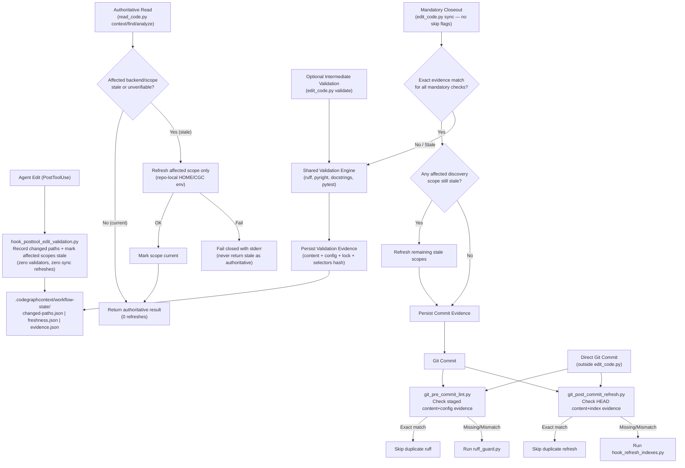

# Combined Plan - 060-consolidate-edit-validation

_Feature: `060-consolidate-edit-validation`_
_Source Spec: `spec.md`_
_Artifact: `plan.md`_

[This template documents every section the combined `speckit.plan` step may keep. `scripts/speckit_plan_step.py` prunes unused sections after triage so the emitted `plan.md` contains only the sections required by strategy.]

## Triage

- duplicate: false
- t_shirt_size: l
- risk_level: medium
- reason: 059-workflow-state-consistency addressed pipeline ledger and health/fingerprint consistency, but did not decouple PostToolUse validation/refresh, introduce reusable validation/commit evidence, remove closeout skip flags, fix bootstrap_session scope aggregation, or isolate ~/.codegraphcontext.

## Strategy Contract

```json
{
  "domains": {
    "reasoning": {
      "build pipeline": "Consolidates PostToolUse hooks, edit_code.py validate/sync, and git pre-commit/post-commit hooks into one coherent validation and refresh pipeline.",
      "caching": "Defines content-, config-, dependency-, and test-selection-bound validation evidence reuse/invalidation and discovery staleness tracking.",
      "code patterns": "Eliminates duplicated validation and refresh orchestration across hooks and scripts while keeping one canonical owner per responsibility.",
      "environment": "Isolates codegraphcontext, read_code.py, bootstrap_session.py, and related local research tools to repo-local paths with zero user-home (~/.codegraphcontext) access.",
      "ops governance": "Enforces unskippable mandatory closeout checks, preserves commit-time fallback safeguards, and aligns workflow documentation with a single owner per seam.",
      "testing": "Requires regression coverage across multi-file intermediate edits, closeout rejection, stale authoritative reads, direct-commit safeguards, and bootstrap failure/isolation checks."
    },
    "relevant": [
      "ops governance",
      "caching",
      "environment",
      "build pipeline",
      "testing",
      "code patterns"
    ]
  },
  "risk": {
    "external_dependency_uncertainty": "low",
    "human_operator_dependency": "low",
    "overall": "medium",
    "repo_uncertainty": "low",
    "requirement_clarity": "low",
    "runtime_side_effect_risk": "medium",
    "state_data_migration_risk": "low"
  },
  "strategy": {
    "architecture_diagram": true,
    "architecture_strategy": true,
    "expanded_design_notes": true,
    "external_research": false,
    "net_new_surface": false,
    "strategy_reason": "Touches six interacting repo-local workflow seams (PostToolUse hook, edit_code.py, discovery readers, bootstrap_session.py, cgc_safe_index.py, and git hooks) where evidence-invalidation boundaries, staleness semantics, and sandbox isolation require explicit architecture, diagramming, and expanded design notes, while all evidence is repo-local."
  },
  "triage": {
    "duplicate": false,
    "duplicate_matches": [],
    "duplicate_reason": "059-workflow-state-consistency addressed pipeline ledger and health/fingerprint consistency, but did not decouple PostToolUse validation/refresh, introduce reusable validation/commit evidence, remove closeout skip flags, fix bootstrap_session scope aggregation, or isolate ~/.codegraphcontext.",
    "risk_level": "medium",
    "tshirt_size": "l"
  }
}
```

## Internal Discovery

### Term: specification

- matches: true
- exit_code: 0
- files:
  - `/Users/andreborczuk/app-foundation/scripts/validate_command_script_coverage.py`

stderr:
```text
Warning: You are sending unauthenticated requests to the HF Hub. Please set a HF_TOKEN to enable higher rate limits and faster downloads.

Loading weights:   0%|          | 0/393 [00:00<?, ?it/s]
Loading weights: 100%|██████████| 393/393 [00:00<00:00, 7649.75it/s]
/Users/andreborczuk/.local/share/uv/python/cpython-3.12-macos-aarch64-none/lib/python3.12/multiprocessing/resource_tracker.py:279: UserWarning: resource_tracker: There appear to be 1 leaked semaphore objects to clean up at shutdown
  warnings.warn('resource_tracker: There appear to be %d '
```

### Term: consolidate

- matches: true
- exit_code: 0
- files:
  - `/Users/andreborczuk/app-foundation/.speckit/runtime/tasking/codex-home/skills/.system/imagegen/scripts/image_gen.py`

stderr:
```text
Warning: You are sending unauthenticated requests to the HF Hub. Please set a HF_TOKEN to enable higher rate limits and faster downloads.

Loading weights:   0%|          | 0/393 [00:00<?, ?it/s]
Loading weights: 100%|██████████| 393/393 [00:00<00:00, 6931.57it/s]
/Users/andreborczuk/.local/share/uv/python/cpython-3.12-macos-aarch64-none/lib/python3.12/multiprocessing/resource_tracker.py:279: UserWarning: resource_tracker: There appear to be 1 leaked semaphore objects to clean up at shutdown
  warnings.warn('resource_tracker: There appear to be %d '
```

### Term: edit

- matches: true
- exit_code: 0
- files:
  - `/Users/andreborczuk/app-foundation/scripts/hook_pretool_dispatch.py`

stderr:
```text
Warning: You are sending unauthenticated requests to the HF Hub. Please set a HF_TOKEN to enable higher rate limits and faster downloads.

Loading weights:   0%|          | 0/393 [00:00<?, ?it/s]
Loading weights: 100%|██████████| 393/393 [00:00<00:00, 8252.45it/s]
/Users/andreborczuk/.local/share/uv/python/cpython-3.12-macos-aarch64-none/lib/python3.12/multiprocessing/resource_tracker.py:279: UserWarning: resource_tracker: There appear to be 1 leaked semaphore objects to clean up at shutdown
  warnings.warn('resource_tracker: There appear to be %d '
```

### Term: validation

- matches: true
- exit_code: 0
- files:
  - `/Users/andreborczuk/app-foundation/src/financial_tracker/metrics/expression.py`

stderr:
```text
Warning: You are sending unauthenticated requests to the HF Hub. Please set a HF_TOKEN to enable higher rate limits and faster downloads.

Loading weights:   0%|          | 0/393 [00:00<?, ?it/s]
Loading weights: 100%|██████████| 393/393 [00:00<00:00, 10730.89it/s]
/Users/andreborczuk/.local/share/uv/python/cpython-3.12-macos-aarch64-none/lib/python3.12/multiprocessing/resource_tracker.py:279: UserWarning: resource_tracker: There appear to be 1 leaked semaphore objects to clean up at shutdown
  warnings.warn('resource_tracker: There appear to be %d '
```

### Term: consumer

- matches: true
- exit_code: 0
- files:
  - `/Users/andreborczuk/app-foundation/src/mcp_codebase/index/telemetry.py`

stderr:
```text
Warning: You are sending unauthenticated requests to the HF Hub. Please set a HF_TOKEN to enable higher rate limits and faster downloads.

Loading weights:   0%|          | 0/393 [00:00<?, ?it/s]
Loading weights: 100%|██████████| 393/393 [00:00<00:00, 7320.91it/s]
/Users/andreborczuk/.local/share/uv/python/cpython-3.12-macos-aarch64-none/lib/python3.12/multiprocessing/resource_tracker.py:279: UserWarning: resource_tracker: There appear to be 1 leaked semaphore objects to clean up at shutdown
  warnings.warn('resource_tracker: There appear to be %d '
```

## Relevant Domains

### ops governance
- Why it matters: Enforces unskippable mandatory closeout checks, preserves commit-time fallback safeguards, and aligns workflow documentation with a single owner per seam.
- Required checklist prompts:
  - [ ] Does a complete specification (WHAT) exist before implementation?
  - [ ] Has a reuse-first approach been seriously evaluated?
  - [ ] Is versioned documentation included with the feature?
  - [ ] Is there an Architecture Flow diagram for the change?
  - [ ] Is component ownership clear?
  - [ ] Are runbooks present/updated for critical operations?
  - [ ] Is incident response/on-call responsibility defined for critical systems?
  - [ ] Are escalation and communication paths defined (where applicable)?
  - [ ] Is there an ADR (or equivalent) for major architectural decisions?
  - [ ] Are learnings fed back into specs/tests/checklists?
  - [ ] Are any rule exceptions documented with rationale and expiry?

### caching
- Why it matters: Defines content-, config-, dependency-, and test-selection-bound validation evidence reuse/invalidation and discovery staleness tracking.
- Required checklist prompts:
  - [ ] Is correctness preserved if the cache is cold, stale, or unavailable?
  - [ ] Is max tolerated staleness explicitly defined (TTL and/or invalidation strategy)?
  - [ ] Is the invalidation/refresh strategy explicitly defined (TTL-only vs event-driven vs write-through/write-behind)?
  - [ ] Are cache keys deterministic, stable, collision-resistant, and free of sensitive data?
  - [ ] Is cache growth bounded (TTL/LRU/size limits/quotas)?
  - [ ] Is there stampede protection for high-fanout keys (singleflight/coalescing/jitter/locks)?
  - [ ] Are private/authenticated responses prevented from leaking via caching (partitioning/no-store)?
  - [ ] Are cache hit/miss/eviction/stale-serve signals observable?
  - [ ] Are p95/p99 latency budgets defined for the relevant critical path?
  - [ ] Is overload behavior explicitly defined (shed/degrade/queue/reject) and safe?
  - [ ] Are caches prevented from amplifying load during outages (stampede + fallback behavior validated)?

### environment
- Why it matters: Isolates codegraphcontext, read_code.py, bootstrap_session.py, and related local research tools to repo-local paths with zero user-home (~/.codegraphcontext) access.
- Required checklist prompts:
  - [ ] Are all secrets loaded from the environment (not files)?
  - [ ] Are setting defaults safe for local-only development?
  - [ ] Is `config.yaml` or equivalent versioned without secrets?
  - [ ] Does startup fail on missing/invalid required configuration?
  - [ ] Is config precedence documented and deterministic?
  - [ ] Are secrets sourced from environment variables (or secret provider) and never logged?
  - [ ] Are defaults safe and environment-appropriate?
  - [ ] Do feature flags have an owner and expiry?
  - [ ] Is production behavior controlled via explicit config (not hardcoded forks)?
  - [ ] Do critical secrets/tokens have an owner and rotation expectations (cadence/trigger)?
  - [ ] Is there a safe, non-secret config fingerprint/version visible at runtime for drift detection?
  - [ ] Are old/rotated secrets revoked or invalidated where applicable?

### build pipeline
- Why it matters: Consolidates PostToolUse hooks, edit_code.py validate/sync, and git pre-commit/post-commit hooks into one coherent validation and refresh pipeline.
- Required checklist prompts:
  - [ ] Are builds reproducible with pinned dependencies and tool versions?
  - [ ] Are artifacts immutable and traceable to commit SHA + build ID?
  - [ ] Is the same artifact promoted across environments (no env-specific builds)?
  - [ ] Are dependency/vulnerability scans run for release builds (and results reviewed/blocked as needed)?
  - [ ] Is an SBOM/provenance artifact produced for production releases (where applicable)?
  - [ ] Are deploy permissions/approvals defined for production-impacting releases, and is the deploy actor attributable?
  - [ ] Are infrastructure/deployment config changes versioned and reviewed as code (where applicable)?
  - [ ] Is rollback documented and tested?
  - [ ] Are schema migrations safe with rollout sequencing (old+new compatibility / expand-contract) or explicitly coordinated?
  - [ ] Is there a post-deploy verification step (smoke/health checks)?
  - [ ] If E2E verification exists for critical flows, is it automated and executed as a release gate (not manual-only)?
  - [ ] Are rollback triggers defined (what signals cause rollback)?
  - [ ] Is a monitoring window defined (what signals, how long) before declaring success?
  - [ ] If change is high-risk, is progressive delivery used (canary/gradual rollout) or explicitly justified if not?

### testing
- Why it matters: Requires regression coverage across multi-file intermediate edits, closeout rejection, stale authoritative reads, direct-commit safeguards, and bootstrap failure/isolation checks.
- Required checklist prompts:
  - [ ] Does a deterministic pass/fail oracle exist for this?
  - [ ] If yes, is it implemented as an automated gate (not manual confirmation)?
  - [ ] Are E2E tests run on real infrastructure where critical paths require it (not mocks)?
  - [ ] Is TDD methodology used (test written first) or explicitly justified if not?
  - [ ] Are tests deterministic (no timing races / hidden randomness / external nondeterminism)?
  - [ ] Are flaky tests tracked with an owner and expiry if temporarily quarantined?
  - [ ] Does every bug fix include a regression test targeting the bug class?
  - [ ] Are state transitions (including retries/duplicates/out-of-order) tested where applicable?
  - [ ] Is there at least one reality-check integration test for critical paths?
  - [ ] Are any gate waivers documented with rationale and expiry?
  - [ ] If E2E gates exist, is the E2E environment production-like or are differences explicitly documented?
  - [ ] Are fixtures/test accounts representative of real edge cases and permission models?

### code patterns
- Why it matters: Eliminates duplicated validation and refresh orchestration across hooks and scripts while keeping one canonical owner per responsibility.
- Required checklist prompts:
  - [ ] Does every new public symbol have its signature (not just a comment) defined in the sketch before the task is implemented?
  - [ ] Are all new modules placed in the correct layer (domain, service, or adapter)? No cross-layer placement?
  - [ ] Does any single function in the sketch exceed 40 lines? If yes, split into smaller sub-tasks first.
  - [ ] Are there any circular imports introduced by this sketch?
  - [ ] Is any business logic (conditionals, decision-making) present in an adapter or file-IO layer? (prohibited)
  - [ ] Is any external IO (database, API, file system) called from domain or service layers? (prohibited)
  - [ ] Do all public functions have complete type hints (parameters and return type)?
  - [ ] Do all service-layer functions return typed objects, not raw dicts or tuples?
  - [ ] Are state transitions explicit and confined to named operations?
  - [ ] Are side effects isolated from decision logic?
  - [ ] Are public failure modes represented with meaningful typed errors/results?
  - [ ] Are public symbols documented (docstrings with inputs/outputs/errors and examples where non-trivial)?
  - [ ] Is formatting/lint enforcement configured as a gate (not advisory)?
  - [ ] Are error-handling conventions consistent within a module boundary (or explicitly documented if mixed)?

## Summary

Consolidate the repository's edit-tracking, technical validation, discovery freshness, commit-safeguard, and session-bootstrap flows into a single evidence-driven lifecycle:

1. **Non-blocking edit tracking**: `scripts/hook_posttool_edit_validation.py` stops running `ruff`, `pyright`, docstring checks, and synchronous index refreshes on intermediate edits; instead it records changed repo-local paths and marks affected discovery backends/scopes stale.
2. **Unified validation & unskippable closeout**: `scripts/edit_code.py` becomes the single owner of optional intermediate validation (`validate`) and mandatory final closeout validation (`sync`), removing `--skip-ruff` / `--skip-pyright` bypass flags from closeout and persisting content-, config-, dependency-, and test-selection-bound validation evidence so unchanged validated states are never re-validated.
3. **On-demand discovery freshness**: Authoritative reads (`scripts/read_code.py` `context`/`find`/`analyze` and `scripts/read_code_health.py`) refresh only stale affected scopes before returning authoritative results, avoid duplicate refreshes on clean state, and fail closed if stale state cannot be refreshed. Task closeout (`edit_code.py sync`) verifies and refreshes any remaining stale discovery scopes before handoff.
4. **Evidence-aware commit safeguards**: `scripts/git_pre_commit_lint.py` and `scripts/git_post_commit_refresh.py` remain active for direct Git commits, skipping duplicate work only when verifiable commit evidence matches the exact staged/committed content and validator/index configuration.
5. **Bootstrap & sandbox isolation**: `scripts/bootstrap_session.py` skips multi-scope `cgc_safe_index.py` runs when `codegraph_health_probe` is already healthy, aggregates failures across all scopes without later successes masking earlier failures, and surfaces actual subprocess `stderr`. All CodeGraph/discovery entrypoints isolate state to repo-local `.codegraphcontext/` paths with zero `~/.codegraphcontext` access.
6. **Documentation and regression coverage**: Align active workflow docs to one unambiguous owner per seam and add end-to-end regression tests for every SC (benchmarking is out of scope for 060 and owned by feature 062).

## Internal Research

- **PostToolUse edit hook (`scripts/hook_posttool_edit_validation.py`)**: `run_posttool_request()` currently runs `_validate_python_paths()` (`scripts/ruff_guard.py`, `scripts/pyright_guard.py`, `scripts/validate_python_docstrings.py`) and then immediately invokes `hook_refresh_indexes.run_refresh_request(payload)` on every edit, blocking temporarily inconsistent multi-file edits and causing repeated validator/refresh runs (violating FR-002, FR-003, FR-010).
- **Edit orchestration (`scripts/edit_code.py`)**: `_build_parser()` currently exposes `--skip-ruff` and `--skip-pyright` on both `validate` and `sync` (violating FR-006 on closeout). `sync` re-runs validation and `hook_refresh_indexes.py` unconditionally without checking whether matching validation or refresh evidence already exists (violating FR-007–FR-009).
- **Discovery freshness & ownership (`scripts/cgc_owner.py`, `scripts/read_code.py`, `scripts/read_code_health.py`, `scripts/hook_refresh_indexes.py`)**: `cgc_owner.py` already defines `codegraph_context_dir()`, `last_edit_signature_file()`, and content edit fingerprinting (deduplicated in 059). `read_code.py` imports `_refresh_indexes_for_read` and `codegraph_current_edit_signature` from `read_code_health.py`, providing a clean seam for per-backend/per-scope staleness markers and fail-closed authoritative reads (FR-010–FR-012).
- **Git commit safeguards (`.githooks/pre-commit`, `.githooks/post-commit`, `scripts/git_pre_commit_lint.py`, `scripts/git_post_commit_refresh.py`)**: Pre-commit unconditionally runs `scripts/ruff_guard.py` on staged Python files; post-commit unconditionally runs `scripts/hook_refresh_indexes.py` on `HEAD` changed paths. Neither inspects governed validation/refresh evidence yet (FR-014–FR-016).
- **Session bootstrap (`scripts/bootstrap_session.py`)**: `bootstrap_session()` calls `codegraph_health_probe(scope)` (`before`), yet unconditionally loops over `WARM_SCOPES = ("scripts", "src", "tests", "specs")` invoking `scripts/cgc_safe_index.py` even when `before.status == "healthy"` (FR-020). Inside the loop, `refreshed = True` on a later scope overwrites `refreshed = False` from an earlier failed scope, and `codegraph_detail` returns `after.detail or before.detail` instead of captured subprocess `stderr` (FR-021).
- **Sandbox/home isolation (`scripts/cgc_safe_index.py`, `scripts/read_code.py`, `scripts/bootstrap_session.py`)**: `_prepare_environment()` sets `CODEGRAPH_CONTEXT_DIR`, `CODEGRAPH_DB_DIR`, `KUZUDB_PATH`, `FALKORDB_PATH`, and `UV_CACHE_DIR`, but upstream `codegraphcontext` still resolves `~/.codegraphcontext` via `HOME` / `Path.home()` inside workspace-scoped sandboxes, causing `PermissionError: [Errno 1] Operation not permitted: '/Users/.../.codegraphcontext'` during sandboxed `cgc` and `read_code.py` runs (FR-022).

## Architecture Strategy

Adopt a **single-owner, evidence-backed state model** stored under repo-local `.codegraphcontext/workflow-state/` (never in user-home directories):

1. **One canonical owner per workflow responsibility**:
   - **Edit tracking & stale marking**: `scripts/hook_posttool_edit_validation.py` → delegates to a shared stdlib-only state module (`scripts/workflow_evidence.py`) so host-Python hooks remain dependency-free.
   - **Optional intermediate validation & mandatory final closeout**: `scripts/edit_code.py` (`validate` and `sync`), sharing the exact same validator runner and evidence-key computation.
   - **On-demand discovery freshness**: `scripts/read_code_health.py` + `scripts/read_code.py` (authoritative reads check stale state, refresh only affected stale scopes, and clear stale markers on success; non-authoritative bounded `window` reads never trigger refreshes).
   - **Commit-time fallback safeguards**: `scripts/git_pre_commit_lint.py` and `scripts/git_post_commit_refresh.py` verify staged/committed content hashes and config hashes against persisted evidence before skipping; any mismatch, missing file, or corrupt record triggers the full safeguard.
   - **Repo-local environment isolation**: A single helper (shared by `cgc_safe_index.py`, `bootstrap_session.py`, `read_code.py`, `read_code_health.py`, and `hook_refresh_indexes.py`) pins `HOME`, `XDG_CONFIG_HOME`, `XDG_CACHE_HOME`, `XDG_DATA_HOME`, `UV_CACHE_DIR`, `SEMBLE_CACHE_LOCATION`, and CodeGraph env vars for child `cgc`/discovery subprocesses to repo-local `.codegraphcontext/home` and `.codegraphcontext/` paths while preserving auth/non-discovery host env outside those child processes.

2. **Fail-closed invariants**:
   - Closeout (`edit_code.py sync`) cannot skip any mandatory check (`ruff`, `pyright`, `validate_python_docstrings`, targeted `pytest`, required docs check, and affected discovery freshness).
   - Evidence reuse requires exact cryptographic digest match across: normalized changed-path content hashes, validator config files (`pyproject.toml`, `ruff.toml`/`.ruff.toml`, `pyrightconfig.json`), dependency lockfile (`uv.lock`), validator identity/version, and targeted test selectors.
   - Authoritative reads never label stale discovery data as authoritative: if a stale scope refresh fails, the read fails explicitly with subprocess diagnostics.

## Architecture Diagram



## Expanded Design Notes

### 1. Validation & Commit Evidence Schema (Resolves OQ-001)
- Stored in `.codegraphcontext/workflow-state/evidence.json` (atomic temp-file + `os.replace` writes, stdlib-only JSON).
- **Evidence key inputs** (SHA-256 digest):
  - `content_hashes`: sorted map of repo-relative path → SHA-256 of file bytes (or `"DELETED"` for deleted paths) for all touched paths in the validation/commit scope.
  - `config_hashes`: SHA-256 of present config files (`pyproject.toml`, `ruff.toml`, `.ruff.toml`, `pyrightconfig.json`, `pytest.ini`).
  - `dependency_hash`: SHA-256 of `uv.lock` (plus Python major.minor version string `sys.version_info[:2]`) — catches dependency/environment drift without invalidating on unrelated transient env vars.
  - `validator_id`: validator name (`ruff`, `pyright`, `docstrings`, `pytest`, `docs`, `refresh:codegraph`, `refresh:vector`).
  - `selectors`: normalized sorted tuple of targeted test selectors (for `pytest`) or normalized scope paths (for `ruff`/`pyright`/`refresh`).
- Any mismatch in content, config, lockfile, Python minor version, or selectors invalidates only the affected validator's evidence entry.

### 2. Authoritative Read Boundary & Discovery Freshness (Resolves OQ-002)
- **Authoritative reads** (require freshness enforcement before returning results):
  - `read_code.py context` (semantic + vector/markdown discovery)
  - `read_code.py find` (CodeGraph structural search)
  - `read_code.py analyze` (CodeGraph callers/calls/chain/deps/tree/variable/dead-code)
- **Non-authoritative / direct reads** (bypass index refresh):
  - `read_code.py window <file> <start> <end>` (reads current file directly from disk)
  - `read_markdown.py` direct file/heading/section reads
- **Freshness state** (`.codegraphcontext/workflow-state/freshness.json`):
  - Tracks per-backend (`codegraph`, `vector`) and per-scope (`scripts`, `src`, `tests`, `specs`, or affected directory) status: `current | stale | unverifiable`, plus `edit_signature` and `last_error`.
  - `hook_posttool_edit_validation.py` maps changed paths to affected backends/scopes and marks them `stale`.
  - An authoritative read checks only the backend(s) and scope(s) it depends on. If `current` and the edit signature matches, zero refreshes occur. If `stale` or `unverifiable`, it runs the scoped refresh, updates status to `current` on exit 0, or marks `unverifiable` and fails closed with captured `stderr`.

### 3. Bootstrap Session & Repo-Local Sandbox Isolation (Resolves OQ-004)
- **Bootstrap health gate (`scripts/bootstrap_session.py`)**:
  - When `before.status == "healthy"` and no tracked scopes are marked stale, return immediately with `warmed_scopes = []`, `codegraph_refreshed = True`, `bootstrap_ok = True`, and zero `cgc_safe_index.py` invocations.
  - When indexing is required, iterate `WARM_SCOPES` collecting `failed_scopes: list[dict[str, Any]]` (scope name, exit code, captured `stderr`/`stdout` excerpt). Set `codegraph_refreshed = (len(failed_scopes) == 0)` so a later succeeding scope can never overwrite an earlier failure. Populate `codegraph_detail` with aggregated subprocess `stderr` whenever any scope fails.
- **Repo-local isolation (`scripts/cgc_owner.py` / `scripts/cgc_safe_index.py`)**:
  - Add a shared `repo_local_tool_env(repo_root, base_env)` helper that creates `.codegraphcontext/home` (and `.codegraphcontext/xdg/{config,cache,data}`) inside the repo and sets `HOME`, `XDG_CONFIG_HOME`, `XDG_CACHE_HOME`, `XDG_DATA_HOME`, `CODEGRAPH_CONTEXT_DIR`, `CODEGRAPH_DB_DIR`, `KUZUDB_PATH`, `FALKORDB_PATH`, `FALKORDB_SOCKET_PATH`, `UV_CACHE_DIR`, and `SEMBLE_CACHE_LOCATION` on discovery/indexing subprocesses.
  - Because `HOME` is overridden only on the discovery/indexing subprocesses (and in-process `cgc` calls restore or isolate via subprocess), parent agent auth/tokens outside discovery are unaffected while upstream `codegraphcontext` never touches `~/.codegraphcontext`.

## Design Slices

### Slice PL-01 - Shared Workflow Evidence, Freshness State, and Repo-Local Tool Env
- Estimate: medium
- Implementation Directive: Create stdlib-only `scripts/workflow_evidence.py` (with atomic JSON persistence under `.codegraphcontext/workflow-state/`) defining typed models and pure functions for: (a) recording changed-path sets, (b) computing validation/commit evidence digests over content hashes, validator configs, `uv.lock`, Python minor version, validator identity, and selectors, (c) tracking per-backend/per-scope discovery freshness (`current`, `stale`, `unverifiable`), and (d) building `repo_local_tool_env()` isolating `HOME`, `XDG_*`, `UV_CACHE_DIR`, `SEMBLE_CACHE_LOCATION`, and CodeGraph paths to `.codegraphcontext/`. Add unit tests covering hash invalidation, atomic state updates, and zero `~/.codegraphcontext` path resolution.

### Slice PL-02 - Decouple PostToolUse Edit Tracking from Validation and Synchronous Refresh
- Estimate: low
- Implementation Directive: Refactor `scripts/hook_posttool_edit_validation.py` so `run_posttool_request()` only records changed repo-local paths and marks affected discovery backends/scopes `stale` via `scripts/workflow_evidence.py`, with zero technical validator (`ruff`, `pyright`, docstring) invocations and zero synchronous `hook_refresh_indexes.py` calls. Add regression tests proving temporarily inconsistent multi-file intermediate edits record zero validator failures and mark the exact affected scopes stale.

### Slice PL-03 - Consolidate Optional Validate and Unskippable Closeout Sync in edit_code.py
- Estimate: high
- Implementation Directive: Update `scripts/edit_code.py` so `validate` and `sync` share one validation engine enforcing `ruff`, `pyright`, `validate_python_docstrings.py`, targeted `pytest`, and required docs checks; remove `--skip-ruff` and `--skip-pyright` bypass paths from closeout (`sync`); consult and persist `scripts/workflow_evidence.py` records so an unchanged validated state runs each mandatory validator at most once; verify and refresh any remaining stale discovery scopes before handoff; and emit commit evidence for staged/committed paths. Add unit and integration tests covering evidence reuse, invalidation on content/config/dependency/selector changes, and 100% closeout rejection on failing checks or unverifiable discovery state.

### Slice PL-04 - On-Demand Discovery Freshness on Authoritative Reads
- Estimate: medium
- Implementation Directive: Update `scripts/read_code_health.py`, `scripts/read_code.py`, and `scripts/hook_refresh_indexes.py` to enforce freshness on authoritative reads (`context`, `find`, `analyze`): skip refresh when affected scopes are `current` (zero duplicate refreshes on repeated reads), refresh only stale affected scopes before returning results, mark refreshed scopes `current`, and fail closed with captured `stderr` (never labeling stale data authoritative) if refresh fails. Ensure non-authoritative `window` reads never trigger refreshes. Add unit and live-backend verification tests covering SC-003 and SC-004.

### Slice PL-05 - Evidence-Aware Git Commit Fallback Safeguards
- Estimate: low
- Implementation Directive: Update `scripts/git_pre_commit_lint.py` and `scripts/git_post_commit_refresh.py` to verify staged/committed content and config hashes against persisted evidence in `scripts/workflow_evidence.py`: skip duplicate `ruff` or refresh only on exact verified match, and execute full safeguards whenever evidence is missing, stale, corrupt, or mismatched (preserving direct Git commit safety). Add regression tests covering both direct commits without evidence and governed commits with matching or mismatched evidence (SC-006).

### Slice PL-06 - Fix bootstrap_session Health Gate, Failure Aggregation, and Repo-Local CGC Isolation
- Estimate: medium
- Implementation Directive: Update `scripts/bootstrap_session.py` and `scripts/cgc_safe_index.py` (plus discovery subprocess calls in `scripts/read_code.py` and `scripts/hook_refresh_indexes.py`) to: (a) skip `cgc_safe_index.py` across `WARM_SCOPES` when `codegraph_health_probe` already reports healthy and no scopes are stale, (b) aggregate failures across all scopes so a later succeeding scope never overwrites an earlier failure, (c) surface actual subprocess `stderr` in `codegraph_detail`, and (d) run all CodeGraph/discovery subprocesses with `repo_local_tool_env()` so `~/.codegraphcontext` is never accessed. Add regression tests (including a sandboxed/restricted-HOME test) verifying SC-008.

### Slice PL-07 - Workflow Documentation Consolidation
- Estimate: low
- Implementation Directive: Update active workflow docs (`AGENTS.md`, `CLAUDE.md` if present, and relevant `.claude/commands/` / runtime docs) so one unambiguous owner and execution point is stated for edit tracking, optional validation, mandatory closeout validation, on-demand freshness, final freshness, and commit fallback safeguards (FR-017, SC-007).

## Plan Completion Summary

- **Selected depth**: Large / medium-risk full architecture plan (`architecture_strategy`, `architecture_diagram`, `expanded_design_notes`, 7 tasking-ready design slices `PL-01`–`PL-07`, no external research needed).
- **Why this depth is sufficient**: Every affected seam is repo-local and directly inspected (`hook_posttool_edit_validation.py`, `edit_code.py`, `read_code.py`, `read_code_health.py`, `hook_refresh_indexes.py`, `bootstrap_session.py`, `cgc_safe_index.py`, `git_pre_commit_lint.py`, `git_post_commit_refresh.py`), all spec decisions are resolved (benchmarking dropped to feature `062`, content-fingerprint reuse confirmed, and repo-local sandbox isolation scoped), and every FR (`FR-001`–`FR-022`) and SC (`SC-001`–`SC-008`) maps cleanly to one of the 7 slices.
- **Next phase**: Run `speckit_plan_step.py finalize` to validate `plan.md` and emit `plan_approved`, then proceed to solution/tasking/implementation via the pipeline driver.
