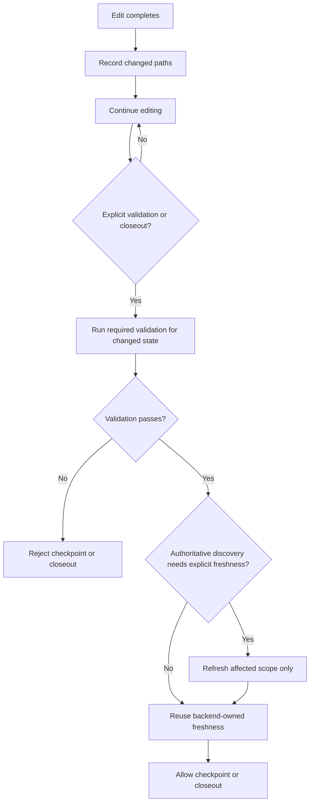

# Feature Specification: Consolidate Edit Validation and Refresh

**Feature Branch**: `060-consolidate-edit-validation`
**Created**: 2026-11-27
**Status**: Draft
**Input**: User description: "Make edits cheap: stop validating and refreshing discovery backends after every edit, track changed paths, validate once at explicit checkpoints, and let discovery systems own freshness where they support it."

## One-Line Purpose *(mandatory)*

Coding agents can make multi-file edits without repeated validation or index-refresh work while final handoff still proves the changed state is valid and discoverable.

## Consumer & Context *(mandatory)*

Codex agents and repository workflows consume this behavior during iterative code editing, validation, discovery, and commit/closeout.

## User Scenarios & Testing *(mandatory)*

### User Story 1 - Edits Stay Cheap (Priority: P1)

As a coding agent, I can make a sequence of edits without Ruff, Pyright, docstring validation, CodeGraph refresh, or vector refresh running after every edit.

**Why this priority**: Per-edit validation and refresh are the main source of duplicated work and make temporarily inconsistent multi-file changes difficult.

**Independent Test**: Make several edits across multiple files and verify the edit hook records the affected paths but runs no technical validator and no discovery refresh.

**Acceptance Scenarios**:

1. **Given** an authorized edit, **When** the edit completes, **Then** the affected paths are tracked and no technical validator runs automatically.
2. **Given** an authorized edit, **When** the edit completes, **Then** no Semble, vector, or CodeGraph refresh is triggered by the edit hook.
3. **Given** several temporarily inconsistent edits, **When** work continues before validation, **Then** the workflow does not block merely because an intermediate state is incomplete.

---

### User Story 2 - Validate Once at Explicit Checkpoints (Priority: P2)

As a coding agent, I can request intermediate validation when useful and receive mandatory final validation at task closeout without repeating successful checks against unchanged state.

**Why this priority**: Safety remains mandatory, but validation should happen at meaningful boundaries rather than after every write.

**Independent Test**: Validate an unchanged state twice and verify mandatory checks run once; change relevant content and verify affected evidence is invalidated.

**Acceptance Scenarios**:

1. **Given** changed code, **When** explicit validation runs, **Then** applicable targeted tests, lint, type, and required documentation checks run against that state.
2. **Given** unchanged successful validation evidence, **When** closeout runs, **Then** equivalent checks are reused rather than repeated.
3. **Given** relevant content or validation configuration changes, **When** closeout runs, **Then** affected evidence is invalidated and required checks rerun.
4. **Given** a mandatory check fails, **When** closeout is attempted, **Then** handoff is rejected.

---

### User Story 3 - Discovery Freshness Has One Owner (Priority: P3)

As a repository agent, I get authoritative discovery results without edit hooks duplicating each backend's freshness lifecycle.

**Why this priority**: Semble already owns its supported cache/index lifecycle, the legacy vector backend is being removed by feature 061, and structural discovery should refresh only when its backend actually requires it.

**Independent Test**: Edit relevant files, perform discovery, and verify no post-edit refresh occurred; Semble works through its MCP-owned lifecycle, the legacy vector backend is not invoked, and any backend that still requires explicit freshness is refreshed only at an authoritative read or closeout boundary.

**Acceptance Scenarios**:

1. **Given** changed files, **When** Semble search runs, **Then** the edit workflow does not perform a separate Semble refresh.
2. **Given** feature 061 migration is complete, **When** edits occur, **Then** no legacy vector refresh/index/reranker path runs.
3. **Given** a structural discovery backend that still requires explicit refresh, **When** an authoritative structural read encounters stale state, **Then** only the affected scope is refreshed before authoritative results are returned.
4. **Given** unchanged current discovery state, **When** authoritative reads repeat, **Then** no duplicate refresh occurs.

### Edge Cases

- An edit changes files and the task is abandoned before validation.
- An authoritative structural read occurs between two edits.
- Direct Git activity occurs outside the governed workflow.
- Validation succeeds, then relevant content changes before closeout.
- A discovery backend reports that it cannot establish freshness.

## Flowchart *(mandatory)*

## Data & State Preconditions *(mandatory)*

- The governed workflow can identify paths changed since the last proven state.
- Validation evidence can be tied to the content/configuration state it proves.
- Discovery backends expose enough readiness/freshness information to avoid presenting known-stale results as authoritative.

## Inputs & Outputs *(mandatory)*

| Direction | Description | Format |
| :-- | :-- | :-- |
| Input | Edit events, changed paths, explicit validation/closeout requests, authoritative discovery requests | Caller-defined |
| Output | Tracked change state, reusable validation evidence, and authoritative discovery results or bounded failures | Caller-defined |

## Constraints & Non-Goals *(mandatory)*

**Must NOT**:
- Run Ruff, Pyright, docstring validation, Semble refresh, legacy vector refresh, or CodeGraph refresh automatically after every edit.
- Recreate Semble cache/index lifecycle in the edit workflow.
- Keep the legacy vector-refresh path after feature 061 removes its consumers.

**Adopted dependencies**:
- Semble MCP owns semantic-discovery freshness through its supported lifecycle.
- Structural discovery uses the configured CodeGraph backend; explicit refresh is required only while that backend requires it.

**Out of scope**:
- Replacing the CodeGraph implementation itself.
- Changing Semble search semantics.

## Requirements *(mandatory)*

### Functional Requirements

- **FR-001**: The workflow MUST track the repository paths affected by each edit so that validation and discovery-freshness decisions cover the relevant change set.
- **FR-002**: Saving an intermediate edit MUST NOT automatically run technical validators or synchronously refresh discovery data.
- **FR-003**: Coding agents MUST be able to sequence, inspect, and revise authorized multi-file changes without mandatory validation between intermediate edits.
- **FR-004**: The workflow MUST provide optional intermediate validation that applies the same pass, failure, and evidence rules used by final validation.
- **FR-005**: Task closeout MUST confirm that every applicable targeted test, lint check, static type check, and required documentation check succeeds before allowing handoff.
- **FR-006**: Task closeout MUST NOT offer a skip option or alternate path that bypasses a mandatory technical check.
- **FR-007**: Successful validation evidence MAY be reused only when the relevant content, validator configuration, dependencies, and test selection are unchanged.
- **FR-008**: A change to relevant content, validator configuration, dependencies, or test selection MUST invalidate the affected validation evidence.
- **FR-009**: For one unchanged validated state, the governed workflow MUST invoke each applicable mandatory validator no more than once.
- **FR-010**: An edit MUST mark each affected discovery backend and scope as stale without forcing an immediate refresh.
- **FR-011**: An authoritative read that depends on stale discovery state MUST refresh the affected scope before returning results, or fail without presenting stale results as authoritative.
- **FR-012**: Repeated authoritative reads against unchanged, current discovery state MUST NOT trigger another refresh.
- **FR-013**: Task closeout MUST verify and, when necessary, refresh every affected repository-discovery data source before handoff succeeds.
- **FR-014**: Commit-time safeguards MUST remain active for direct Git activity outside the governed task workflow.
- **FR-015**: A commit-time validation or refresh MAY be skipped only when evidence proves that the exact staged or committed content and relevant configuration already satisfy that safeguard.
- **FR-016**: Missing, stale, unverifiable, or mismatched commit evidence MUST cause the existing commit-time safeguard to run.
- **FR-017**: Workflow documentation MUST identify one unambiguous owner and execution point for edit tracking, optional validation, mandatory final validation, on-demand freshness, final freshness, and commit fallback safeguards.
- **FR-018**: Existing bounded-read rules, discovery entry points, governance gates, audit trails, continuous-integration checks, and behavioral and semantic quality checks MUST remain effective.
- **FR-019**: Regression coverage MUST include intermediate-edit behavior, optional and final validation, direct-commit safeguards, freshness detection, and a temporarily inconsistent multi-file change that passes all final checks after consistency is restored.
- **FR-020**: Session bootstrap (`scripts/bootstrap_session.py`) MUST NOT invoke `scripts/cgc_safe_index.py` across `scripts`, `src`, `tests`, and `specs` when `codegraph_health_probe` already reports a healthy snapshot.
- **FR-021**: When session bootstrap does run multi-scope indexing, it MUST aggregate failure state across all scopes (never allowing a later succeeding scope to overwrite an earlier scope's failure) and MUST surface actual subprocess stderr instead of masking failures with a healthy probe detail message.
- **FR-022**: Repository discovery and indexing entrypoints (including `cgc_safe_index.py`, `read_code.py`, and related local research tools) MUST isolate their config, cache, and database state to repo-local paths rather than reading or writing `~/.codegraphcontext` or other user-home paths outside the workspace sandbox.

### Key Entities

- **Changed-path set**: The bounded collection of repository paths affected since the last proven state.
- **Validation evidence**: Proof of successful technical checks tied to the relevant content, configuration, dependencies, test selection, and validator identity.
- **Discovery freshness state**: The current, stale, or unverifiable status of an affected discovery backend and scope.
- **Commit evidence**: Proof that a commit safeguard already succeeded against the exact staged or committed state and relevant configuration.
- **Task closeout decision**: The permitted or rejected handoff based on mandatory validation, discovery freshness, governance, and quality checks.

## Success Criteria *(mandatory)*

### Measurable Outcomes

- **SC-001**: A regression scenario with temporarily inconsistent multi-file edits records zero automatic technical-validator failures during intermediate edits and passes mandatory final validation after consistency is restored.
- **SC-002**: For an unchanged successful governed task, each applicable mandatory technical validator runs no more than once for the validated state.
- **SC-003**: Repeated authoritative reads against unchanged, current content cause zero duplicate refreshes for every supported discovery backend.
- **SC-004**: In regression coverage, 100% of authoritative reads that encounter stale discovery state either refresh before returning results or fail without labeling stale results authoritative.
- **SC-005**: In regression coverage, 100% of closeout attempts containing a failing targeted test, lint error, type error, missing required documentation, or unverifiable affected discovery state are rejected.
- **SC-006**: In regression coverage, direct commits with missing or mismatched evidence execute the applicable safeguards, while exact matching evidence causes no duplicate validator or refresh invocation.
- **SC-007**: A review of active workflow documentation finds no contradictory ownership or timing rules for edit tracking, intermediate validation, final validation, discovery refresh, or commit safeguards.
- **SC-008**: In regression coverage, `bootstrap_session()` triggers zero `cgc_safe_index.py` invocations when the CodeGraph snapshot is already healthy, fails deterministically if any scope fails (even when a later scope succeeds), surfaces actual subprocess stderr on failure, and operates strictly within repo-local paths with zero `~/.codegraphcontext` access.

## Definition of Done *(mandatory)*

The feature is complete in the production repository workflow when coding agents can assemble temporarily inconsistent multi-file edits without automatic technical validation, every successful closeout passes mandatory quality and discovery-freshness checks, unchanged proven work is not repeated, direct Git activity retains its safeguards, repo-local discovery isolation prevents `~/.codegraphcontext` access, and all measurable outcomes above are demonstrated by regression coverage.

## Resolved Decisions

- **Validation evidence boundary**: Reuse the existing `scripts/cgc_owner.py` content-fingerprint model combined with relevant validator configuration (`pyproject.toml`, `uv.lock`) and targeted test selection; full Python environment fingerprinting is out of scope.
- **Authoritative read boundary**: Reuse the existing index-backed freshness checks for `read_code.py` (`context`, `find`, `analyze`), `cgc`, and `semble`; direct disk reads (`read_code.py window`, `read_markdown.py`) do not require index refresh.
- **Benchmarking**: Dropped from `060` (owned by feature `062`).
- **Sandbox isolation**: Isolate `codegraphcontext` and sibling local discovery wrappers via repo-local environment/path configuration inside the repo entrypoints.
