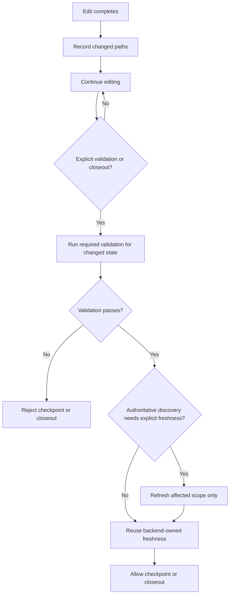

# Feature Specification: Consolidate Edit Validation and Refresh

**Feature Branch**: `060-consolidate-edit-validation`
**Created**: 2026-11-27
**Status**: Draft
**Input**: User description: "Make edits cheap: stop validating and refreshing discovery backends after every edit, track changed paths, validate once at explicit checkpoints, and let discovery systems own freshness where they support it."

## One-Line Purpose *(mandatory)*

Coding agents can make multi-file edits without repeated validation or index-refresh work while final handoff still proves the changed state is valid and discoverable.

## Consumer & Context *(mandatory)*

Codex agents and repository workflows consume this behavior during iterative code editing, validation, discovery, and commit/closeout.

## User Scenarios & Testing *(mandatory)*

### User Story 1 - Edits Stay Cheap (Priority: P1)

As a coding agent, I can make a sequence of edits without Ruff, Pyright, docstring validation, CodeGraph refresh, or vector refresh running after every edit.

**Why this priority**: Per-edit validation and refresh are the main source of duplicated work and make temporarily inconsistent multi-file changes difficult.

**Independent Test**: Make several edits across multiple files and verify the edit hook records the affected paths but runs no technical validator and no discovery refresh.

**Acceptance Scenarios**:

1. **Given** an authorized edit, **When** the edit completes, **Then** the affected paths are tracked and no technical validator runs automatically.
2. **Given** an authorized edit, **When** the edit completes, **Then** no Semble, vector, or CodeGraph refresh is triggered by the edit hook.
3. **Given** several temporarily inconsistent edits, **When** work continues before validation, **Then** the workflow does not block merely because an intermediate state is incomplete.

---

### User Story 2 - Validate Once at Explicit Checkpoints (Priority: P2)

As a coding agent, I can request intermediate validation when useful and receive mandatory final validation at task closeout without repeating successful checks against unchanged state.

**Why this priority**: Safety remains mandatory, but validation should happen at meaningful boundaries rather than after every write.

**Independent Test**: Validate an unchanged state twice and verify mandatory checks run once; change relevant content and verify affected evidence is invalidated.

**Acceptance Scenarios**:

1. **Given** changed code, **When** explicit validation runs, **Then** applicable targeted tests, lint, type, and required documentation checks run against that state.
2. **Given** unchanged successful validation evidence, **When** closeout runs, **Then** equivalent checks are reused rather than repeated.
3. **Given** relevant content or validation configuration changes, **When** closeout runs, **Then** affected evidence is invalidated and required checks rerun.
4. **Given** a mandatory check fails, **When** closeout is attempted, **Then** handoff is rejected.

---

### User Story 3 - Discovery Freshness Has One Owner (Priority: P3)

As a repository agent, I get authoritative discovery results without edit hooks duplicating each backend's freshness lifecycle.

**Why this priority**: Semble already owns its supported cache/index lifecycle, the legacy vector backend is being removed by feature 061, and structural discovery should refresh only when its backend actually requires it.

**Independent Test**: Edit relevant files, perform discovery, and verify no post-edit refresh occurred; Semble works through its MCP-owned lifecycle, the legacy vector backend is not invoked, and any backend that still requires explicit freshness is refreshed only at an authoritative read or closeout boundary.

**Acceptance Scenarios**:

1. **Given** changed files, **When** Semble search runs, **Then** the edit workflow does not perform a separate Semble refresh.
2. **Given** feature 061 migration is complete, **When** edits occur, **Then** no legacy vector refresh/index/reranker path runs.
3. **Given** a structural discovery backend that still requires explicit refresh, **When** an authoritative structural read encounters stale state, **Then** only the affected scope is refreshed before authoritative results are returned.
4. **Given** unchanged current discovery state, **When** authoritative reads repeat, **Then** no duplicate refresh occurs.

### Edge Cases

- An edit changes files and the task is abandoned before validation.
- An authoritative structural read occurs between two edits.
- Direct Git activity occurs outside the governed workflow.
- Validation succeeds, then relevant content changes before closeout.
- A discovery backend reports that it cannot establish freshness.

## Flowchart *(mandatory)*

## Data & State Preconditions *(mandatory)*

- The governed workflow can identify paths changed since the last proven state.
- Validation evidence can be tied to the content/configuration state it proves.
- Discovery backends expose enough readiness/freshness information to avoid presenting known-stale results as authoritative.

## Inputs & Outputs *(mandatory)*

| Direction | Description | Format |
| :-- | :-- | :-- |
| Input | Edit events, changed paths, explicit validation/closeout requests, authoritative discovery requests | Caller-defined |
| Output | Tracked change state, reusable validation evidence, and authoritative discovery results or bounded failures | Caller-defined |

## Constraints & Non-Goals *(mandatory)*

**Must NOT**:
- Run Ruff, Pyright, docstring validation, Semble refresh, legacy vector refresh, or CodeGraph refresh automatically after every edit.
- Recreate Semble cache/index lifecycle in the edit workflow.
- Keep the legacy vector-refresh path after feature 061 removes its consumers.

**Adopted dependencies**:
- Semble MCP owns semantic-discovery freshness through its supported lifecycle.
- Structural discovery uses the configured CodeGraph backend; explicit refresh is required only while that backend requires it.

**Out of scope**:
- Replacing the CodeGraph implementation itself.
- Changing Semble search semantics.

## Requirements *(mandatory)*

### Functional Requirements

- **FR-001**: The workflow MUST track repository paths affected since the last proven state.
- **FR-002**: Post-edit hooks MUST NOT automatically run technical validators or discovery refreshes.
- **FR-003**: Agents MUST be able to make temporarily inconsistent multi-file edits before explicit validation.
- **FR-004**: Optional intermediate validation and mandatory closeout validation MUST use the same evidence rules.
- **FR-005**: Successful validation evidence MAY be reused only while the relevant content, validator configuration, dependencies, and test selection remain unchanged.
- **FR-006**: Closeout MUST reject failing mandatory checks and MUST NOT provide a bypass path.
- **FR-007**: Semble freshness MUST remain owned by the standard Semble MCP integration; edit hooks MUST NOT invoke a separate Semble refresh.
- **FR-008**: The legacy vector refresh/index/reranker path MUST NOT be invoked from edit hooks and MUST be removed as feature 061 retires its remaining consumers.
- **FR-009**: A discovery backend that still requires explicit freshness MAY refresh only at an authoritative read or final closeout boundary, scoped to affected paths; unchanged current state MUST NOT refresh again.
- **FR-010**: The current `hook_posttool_edit_validation.py` behavior that runs Ruff, Pyright, docstring checks, and delegates to `hook_refresh_indexes.py` after each edit MUST be removed from the normal PostToolUse edit path.
- **FR-011**: `hook_refresh_indexes.py` MUST NOT remain a generic per-edit vector/CodeGraph refresh mechanism; any temporary compatibility use for a backend requiring explicit refresh MUST be on-demand and scoped.
- **FR-012**: Commit-time safeguards MUST remain available for direct Git activity outside the governed workflow and MAY reuse exact matching validation/freshness evidence.
- **FR-013**: Missing, stale, or mismatched evidence MUST cause the applicable closeout or commit safeguard to run.
- **FR-014**: Before-and-after verification MUST measure validator invocations, refresh invocations, validation elapsed time, and task completion time without reducing acceptance-test success.

## Success Criteria *(mandatory)*

### Measurable Outcomes

- **SC-001**: A multi-file edit sequence records zero automatic technical-validator invocations and zero automatic discovery-refresh invocations during intermediate edits.
- **SC-002**: For one unchanged validated state, each applicable mandatory validator runs no more than once.
- **SC-003**: Semble discovery requires zero edit-hook refresh calls.
- **SC-004**: After feature 061 migration, normal workflows record zero legacy vector refresh/index/reranker invocations.
- **SC-005**: Repeated authoritative structural reads against unchanged current state cause zero duplicate refreshes.
- **SC-006**: Every closeout containing a failing mandatory check or unverifiable required discovery state is rejected.
- **SC-007**: Direct commits without matching evidence execute the applicable fallback safeguard.
- **SC-008**: Equivalent benchmark tasks show fewer validator and refresh invocations without reducing acceptance-test success.

## Definition of Done *(mandatory)*

This feature is shipped when production edit workflows only track changed paths during ordinary edits, validation runs at explicit checkpoints or closeout, Semble owns its own freshness lifecycle, obsolete vector refreshes are gone, and any remaining explicit structural refresh occurs only when an authoritative boundary requires it.

## Open Questions *(include if any unresolved decisions exist)*

- **OQ-001**: Until CodeGraph is replaced by a backend with self-managed freshness, which structural reads are authoritative enough to trigger its temporary scoped refresh? **Stakes**: Too broad recreates the current cost; too narrow can return stale structural results.
