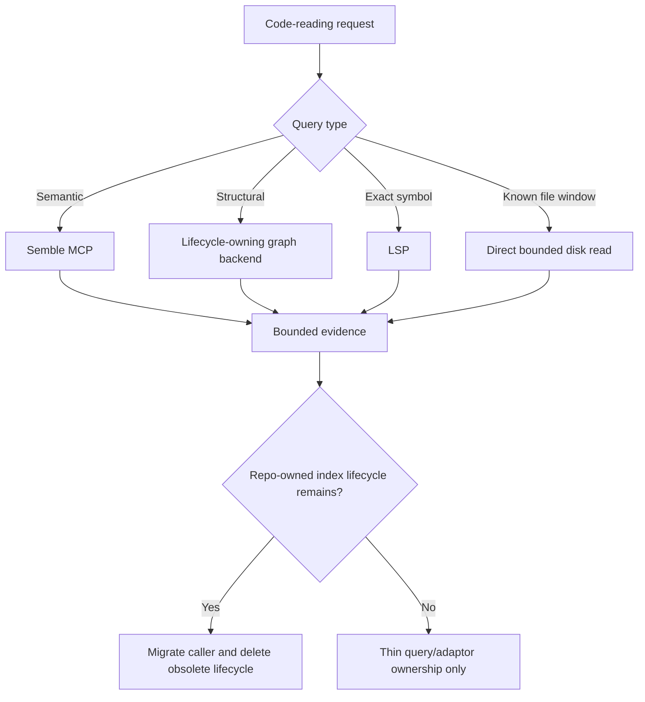

# Feature Specification: Externalize Repository Discovery Lifecycles

**Feature Branch**: `061-persistent-repo-research-backends`
**Created**: 2026-11-27
**Status**: Draft
**Input**: User description: "Make code reading a thin consumer of lifecycle-owning discovery systems: stabilize Semble, remove the legacy semantic vector stack, externalize structural graph indexing/freshness, preserve structural capabilities, and delete repo-owned indexing/watching/recovery machinery."

## One-Line Purpose *(mandatory)*

Repository agents use reliable semantic, structural, and exact-symbol discovery while the repository owns no semantic or graph indexing, watching, freshness, persistence, or recovery lifecycle.

## Consumer & Context *(mandatory)*

Codex agents and SpecKit workflows consume lifecycle-owning semantic and structural discovery backends plus LSP through narrow repository integrations during code discovery.

## User Scenarios & Testing *(mandatory)*

### User Story 1 - Reliable Semble MCP (Priority: P1)

As a repository agent, I can use Semble in fresh Codex sessions without manual recovery or unnecessary approval prompts.

**Why this priority**: The legacy semantic path cannot be removed safely until Semble is dependable.

**Independent Test**: Start fresh Codex sessions and verify Semble registers, searches successfully, and reports a concrete startup/configuration failure when unavailable.

**Acceptance Scenarios**:

1. **Given** valid MCP configuration, **When** a fresh Codex session starts, **Then** Semble search tools are available.
2. **Given** a healthy Semble MCP, **When** five searches run in one session, **Then** they reuse the existing MCP process path rather than intentionally starting one Semble process per query.
3. **Given** the intended read-only approval policy, **When** Semble searches run, **Then** they do not prompt unnecessarily.
4. **Given** Semble cannot start or register, **When** readiness is checked, **Then** the failure identifies the relevant configuration, environment/executable, working-directory, process-start, or tool-registration cause.

---

### User Story 2 - Remove Legacy Vector Discovery (Priority: P2)

As a maintainer, I can remove the old vector/read-code semantic-discovery stack after Semble is stable.

**Why this priority**: It duplicates Semble and adds index, embedding, reranking, refresh, persistence, and health machinery.

**Independent Test**: Inventory remaining legacy semantic callers, migrate valid consumers to Semble, and verify normal discovery no longer initializes or queries the legacy vector backend.

**Acceptance Scenarios**:

1. **Given** a normal semantic-discovery request, **When** discovery runs, **Then** it uses Semble rather than the legacy vector backend.
2. **Given** legacy vector/index/embed/rerank lifecycle code with no remaining consumer, **When** cleanup completes, **Then** that code is removed.
3. **Given** existing retrieval guardrails, CodeGraph, and LSP behavior, **When** cleanup completes, **Then** those unaffected capabilities continue to pass regression checks.

### User Story 3 - Externalize Structural Graph Lifecycle (Priority: P1)

As a repository agent, I retain callers, callees, dependencies, hierarchy, impact, and blast-radius analysis without repository-owned graph indexing, watching, freshness, persistence, locking, recovery, or refresh orchestration.

**Why this priority**: Structural discovery is fundamental to planning and implementation, but the current CodeGraph lifecycle forces the repository to maintain indexing hooks, database paths, locks, recovery logic, health probes, and stale-state coordination that should belong to the graph backend.

**Independent Test**: Run representative structural queries before and after migration and verify equivalent useful results while edits become discoverable through the selected backend's own lifecycle with no repository refresh command or stale-state write.

**Acceptance Scenarios**:

1. **Given** a repository edit, **When** a structural query runs after the backend's supported freshness boundary, **Then** current structural results are available without invoking `cgc_safe_index.py`, `hook_refresh_indexes.py`, or repository-owned graph refresh logic.
2. **Given** representative structural questions, **When** the replacement backend is evaluated, **Then** callers, callees, dependencies, hierarchy, impact, and blast-radius behavior are demonstrated before the old backend lifecycle is removed.
3. **Given** a candidate structural backend that requires the repository to own its watcher, refresh scheduler, graph database recovery, or stale-state lifecycle, **When** architecture selection is performed, **Then** that candidate does not satisfy this feature's ownership objective without an explicitly approved exception.
4. **Given** the replacement structural backend is proven, **When** migration completes, **Then** obsolete CodeGraph lifecycle wrappers, refresh hooks, locks, database ownership, recovery paths, and backend-specific freshness state are removed rather than retained as fallback machinery.

---

### User Story 4 - Thin Code-Reading Ownership Boundary (Priority: P2)

As a maintainer, I can understand the complete code-reading architecture from one small ownership contract and verify that the repository owns only query policy, bounded reads, and thin adapters—not discovery infrastructure.

**Why this priority**: Removing one backend is insufficient if equivalent lifecycle machinery survives under another wrapper.

**Independent Test**: Inventory the post-migration repository and verify every remaining discovery/indexing component has an active consumer and that no repository component owns semantic or structural index build, watching, freshness, persistence, recovery, or reranker lifecycle.

**Acceptance Scenarios**:

1. **Given** post-migration code, **When** discovery ownership is audited, **Then** Semble owns semantic indexing/freshness, the selected structural backend owns graph indexing/freshness/persistence/recovery, LSP owns exact language intelligence, and direct disk readers own bounded file windows.
2. **Given** superseded semantic or graph lifecycle code, **When** no active consumer remains, **Then** it is deleted rather than left dormant.
3. **Given** the migration is benchmarked, **When** before/after results are compared, **Then** latency, token use, task success, and repository code/indexing surface are reported so the simplification is measurable.

### Edge Cases

- Semble launches but expected tools do not register.
- A legacy semantic caller remains after migration.
- A fresh session resolves the wrong repository or working directory.
- The structural backend is healthy but has not yet observed a recent edit.
- A structural candidate covers common call/dependency queries but materially regresses cross-file impact analysis.
- A supposedly deleted lifecycle component still has a hidden caller.

## Flowchart *(mandatory)*

## Data & State Preconditions *(mandatory)*

- The target repository is known for the active Codex/SpecKit session.
- Semble is configured through the standard local MCP integration.
- LSP remains available for exact language intelligence.
- The current structural backend remains available until a lifecycle-owning replacement is proven against representative structural queries.
- A before/after benchmark path exists (owned by the repository benchmarking work) for latency, token use, task success, and code/indexing surface measurements.

## Inputs & Outputs *(mandatory)*

| Direction | Description | Format |
| :-- | :-- | :-- |
| Input | Repository context and semantic, structural, exact-symbol, or bounded-read request | Caller-defined |
| Output | Bounded discovery result from the owning backend, or a concrete readiness/capability failure | Caller-defined |

## Constraints & Non-Goals *(mandatory)*

**Must NOT**:
- Add a separate Semble daemon, HTTP service, process pool, batching layer, or duplicate semantic index lifecycle.
- Preserve the legacy vector backend merely as a fallback after its consumers are migrated.
- Replace CodeGraph with another backend that still requires repository-owned indexing, watching, freshness, persistence, locking, recovery, or refresh scheduling unless an explicit exception is approved.
- Add a new repository freshness database or backend-specific lifecycle abstraction to compensate for a replacement tool.
- Redesign structural query semantics merely to justify a backend migration.

**Adopted dependencies**:
- Semble MCP provides semantic repository discovery and owns its supported cache/index behavior.
- The selected structural backend MUST own its supported graph index build, watch/update lifecycle, freshness, persistence, and recovery behavior while exposing sufficient callers/callees/dependencies/hierarchy/impact/blast-radius capability.
- LSP provides exact symbol, definition, reference, and diagnostic intelligence.

**Target ownership contract**:
- **Semble**: semantic candidate discovery and semantic index/cache lifecycle.
- **Structural graph backend**: callers, callees, dependencies, hierarchy, impact/blast radius, plus graph indexing/watch/freshness/persistence/recovery lifecycle.
- **LSP**: exact language intelligence.
- **Direct disk readers**: bounded windows after a path/anchor is known.
- **Repository code**: query policy, capability selection, bounded-result handling, and thin adapters only.

**Deletion boundary**:
After consumers are migrated, remove obsolete repository-owned components for:
- Chroma/FastEmbed/FlagEmbedding semantic indexing and embeddings.
- local reranker daemon/worker/model lifecycle used only by the legacy semantic path.
- legacy vector health, fingerprint, refresh, persistence, and fallback-query machinery.
- semantic portions of `hook_refresh_indexes.py`, `mcp_codebase/index`, and `read_code.py` that exist only to operate the superseded vector backend.
- CodeGraph refresh hooks, `cgc_safe_index.py` lifecycle orchestration, graph database ownership/recovery/locking, and backend-specific freshness state once the structural replacement is proven.
- dependencies, tests, docs, and configuration that have no remaining active consumer.

**Out of scope**:
- Redesigning LSP.
- Changing the meaning of callers/callees/dependencies/impact merely to fit a replacement backend.
- Building the benchmark framework itself; this feature consumes the repository's benchmarking/evaluation path to prove the migration.

## Requirements *(mandatory)*

### Functional Requirements

- **FR-001**: The standard local Semble MCP MUST be the normal semantic repository-discovery path.
- **FR-002**: Fresh Codex sessions MUST expose Semble search tools when configuration and environment are valid.
- **FR-003**: Repeated searches in one session MUST use the existing MCP process path without custom per-query Semble process orchestration.
- **FR-004**: Semble readiness failures MUST identify the relevant startup/configuration category instead of reporting only a generic unavailable state.
- **FR-005**: Read-only Semble searches MUST run without repetitive approval prompts when the intended policy is configured.
- **FR-006**: After Semble stability is verified, legacy semantic vector callers MUST be migrated or explicitly justified, and unused vector/index/embed/rerank lifecycle code MUST be removed.
- **FR-007**: Existing retrieval guardrails and LSP symbol analysis MUST continue to pass regression checks; feature 059 and related docs MUST stop assigning warmed-reranker ownership to feature 061.
- **FR-008**: Before replacing the current structural backend, the selected backend MUST demonstrate representative callers, callees, dependencies, hierarchy, impact, and blast-radius queries against this repository.
- **FR-009**: The selected structural backend MUST own its supported indexing, watch/update lifecycle, freshness, persistence, and recovery behavior; normal repository workflows MUST NOT invoke backend-specific graph refresh orchestration after migration.
- **FR-010**: Once structural replacement is proven, repository-owned CodeGraph lifecycle machinery—including refresh hooks, database ownership/recovery/locking, stale-state coordination, and obsolete health/bootstrap wrappers—MUST be removed unless a remaining active consumer is documented.
- **FR-011**: Post-migration repository code MUST NOT own semantic or structural index build, watcher, freshness, persistence, recovery, reranker, or refresh-scheduling lifecycles.
- **FR-012**: Every remaining semantic/vector/graph lifecycle component MUST have a documented active consumer; unused components, dependencies, tests, docs, and configuration MUST be deleted rather than retained as fallback.
- **FR-013**: The post-migration discovery contract MUST be explicit: Semble for semantic discovery, the selected graph backend for structural discovery, LSP for exact language intelligence, and direct disk readers for bounded file windows.
- **FR-014**: Before/after migration evidence MUST report code-reading latency, token use, task success, and repository code/indexing surface so the effect of deleting lifecycle machinery is measurable.
- **FR-015**: The migration MUST reduce the repository-owned code/configuration surface that discovery systems themselves must index; the final inventory MUST quantify removed discovery-related files or LOC and dependencies where practical.

## Success Criteria *(mandatory)*

### Measurable Outcomes

- **SC-001**: Fresh-session verification repeatedly exposes working Semble search tools without manual recovery.
- **SC-002**: Five searches in one healthy session complete through the existing Semble MCP path without intentional per-query process startup.
- **SC-003**: Read-only Semble searches run without unexpected approval prompts under the configured policy.
- **SC-004**: Normal post-migration discovery does not initialize or query the legacy vector backend.
- **SC-005**: Remaining legacy semantic components each have a documented active consumer; unused components are removed and regression checks pass.
- **SC-006**: Representative structural queries for callers, callees, dependencies, hierarchy, impact, and blast radius pass the agreed migration comparison before the old graph lifecycle is removed.
- **SC-007**: Normal post-migration edits and structural reads invoke zero repository-owned graph refresh commands, watcher orchestration, stale-state writes, database recovery paths, or backend-specific refresh scheduling.
- **SC-008**: A post-migration ownership audit finds zero repository-owned semantic or structural index-build, watcher, freshness, persistence, recovery, or reranker lifecycles outside documented temporary compatibility exceptions.
- **SC-009**: Before/after benchmark evidence reports latency, token use, and task-success results for representative discovery-dependent tasks, with no material success-rate regression accepted merely to reduce code.
- **SC-010**: The final deletion inventory reports the discovery-related files/LOC and dependencies removed so the reduction in code that agents and indexes must process is visible.

## Definition of Done *(mandatory)*

This feature is shipped when production workflows use Semble for semantic discovery, a lifecycle-owning graph backend for structural discovery, LSP for exact language intelligence, and bounded direct reads for known files; superseded semantic and graph lifecycle machinery is deleted; normal workflows own no semantic or structural indexing/watching/freshness/persistence/recovery lifecycle; and before/after benchmark plus deletion evidence demonstrates the simplification without material task-success regression.

## Open Questions *(include if any unresolved decisions exist)*

None.
