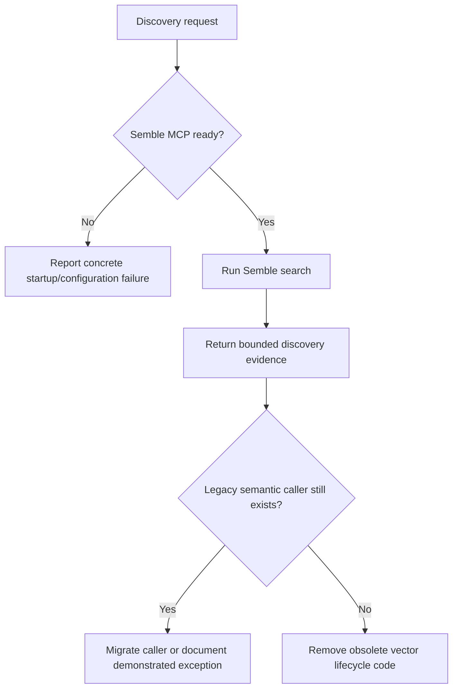

# Feature Specification: Stable Semble MCP and Legacy Vector Removal

**Feature Branch**: `061-persistent-repo-research-backends`
**Created**: 2026-11-27
**Status**: Draft
**Input**: User description: "Make Semble MCP reliable first, then remove the legacy vector-search/read-code semantic discovery machinery it replaces."

## One-Line Purpose *(mandatory)*

Repository agents use reliable Semble semantic discovery without maintaining a second legacy vector-search stack.

## Consumer & Context *(mandatory)*

Codex agents and SpecKit workflows consume Semble through the repository's standard local MCP integration during code discovery.

## User Scenarios & Testing *(mandatory)*

### User Story 1 - Reliable Semble MCP (Priority: P1)

As a repository agent, I can use Semble in fresh Codex sessions without manual recovery or unnecessary approval prompts.

**Why this priority**: The legacy semantic path cannot be removed safely until Semble is dependable.

**Independent Test**: Start fresh Codex sessions and verify Semble registers, searches successfully, and reports a concrete startup/configuration failure when unavailable.

**Acceptance Scenarios**:

1. **Given** valid MCP configuration, **When** a fresh Codex session starts, **Then** Semble search tools are available.
2. **Given** a healthy Semble MCP, **When** five searches run in one session, **Then** they reuse the existing MCP process path rather than intentionally starting one Semble process per query.
3. **Given** the intended read-only approval policy, **When** Semble searches run, **Then** they do not prompt unnecessarily.
4. **Given** Semble cannot start or register, **When** readiness is checked, **Then** the failure identifies the relevant configuration, environment/executable, working-directory, process-start, or tool-registration cause.

---

### User Story 2 - Remove Legacy Vector Discovery (Priority: P2)

As a maintainer, I can remove the old vector/read-code semantic-discovery stack after Semble is stable.

**Why this priority**: It duplicates Semble and adds index, embedding, reranking, refresh, persistence, and health machinery.

**Independent Test**: Inventory remaining legacy semantic callers, migrate valid consumers to Semble, and verify normal discovery no longer initializes or queries the legacy vector backend.

**Acceptance Scenarios**:

1. **Given** a normal semantic-discovery request, **When** discovery runs, **Then** it uses Semble rather than the legacy vector backend.
2. **Given** legacy vector/index/embed/rerank lifecycle code with no remaining consumer, **When** cleanup completes, **Then** that code is removed.
3. **Given** existing retrieval guardrails, CodeGraph, and LSP behavior, **When** cleanup completes, **Then** those unaffected capabilities continue to pass regression checks.

### Edge Cases

- Semble launches but expected tools do not register.
- A legacy semantic caller remains after migration.
- A fresh session resolves the wrong repository or working directory.

## Flowchart *(mandatory)*

## Data & State Preconditions *(mandatory)*

- The target repository is known for the active Codex/SpecKit session.
- Semble is configured through the standard local MCP integration.
- Existing CodeGraph and LSP integrations remain available for their current responsibilities.

## Inputs & Outputs *(mandatory)*

| Direction | Description | Format |
| :-- | :-- | :-- |
| Input | Repository context and semantic discovery request | Caller-defined |
| Output | Semble discovery result or concrete MCP readiness failure | Caller-defined |

## Constraints & Non-Goals *(mandatory)*

**Must NOT**:
- Add a separate Semble daemon, HTTP service, process pool, batching layer, or duplicate index lifecycle.
- Preserve the legacy vector backend merely as a fallback after its consumers are migrated.

**Adopted dependencies**:
- Semble MCP provides semantic repository discovery and owns its supported cache/index behavior.

**Out of scope**:
- Replacing or redesigning CodeGraph.
- Replacing or redesigning LSP.

## Requirements *(mandatory)*

### Functional Requirements

- **FR-001**: The standard local Semble MCP MUST be the normal semantic repository-discovery path.
- **FR-002**: Fresh Codex sessions MUST expose Semble search tools when configuration and environment are valid.
- **FR-003**: Repeated searches in one session MUST use the existing MCP process path without custom per-query Semble process orchestration.
- **FR-004**: Semble readiness failures MUST identify the relevant startup/configuration category instead of reporting only a generic unavailable state.
- **FR-005**: Read-only Semble searches MUST run without repetitive approval prompts when the intended policy is configured.
- **FR-006**: After Semble stability is verified, legacy semantic vector callers MUST be migrated or explicitly justified, and unused vector/index/embed/rerank lifecycle code MUST be removed.
- **FR-007**: Existing retrieval guardrails, CodeGraph structural analysis, and LSP symbol analysis MUST continue to pass regression checks; feature 059 and related docs MUST stop assigning warmed-reranker ownership to feature 061.

## Success Criteria *(mandatory)*

### Measurable Outcomes

- **SC-001**: Fresh-session verification repeatedly exposes working Semble search tools without manual recovery.
- **SC-002**: Five searches in one healthy session complete through the existing Semble MCP path without intentional per-query process startup.
- **SC-003**: Read-only Semble searches run without unexpected approval prompts under the configured policy.
- **SC-004**: Normal post-migration discovery does not initialize or query the legacy vector backend.
- **SC-005**: Remaining legacy semantic components each have a documented active consumer; unused components are removed and regression checks pass.

## Definition of Done *(mandatory)*

This feature is shipped when production workflows reliably use the standard Semble MCP for semantic discovery and the superseded legacy vector-search machinery is removed without regressing existing retrieval guardrails, CodeGraph, or LSP behavior.

## Open Questions *(include if any unresolved decisions exist)*

None.
