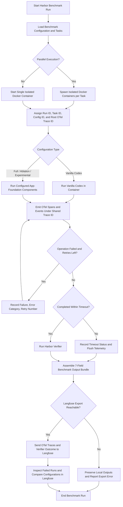

# Feature Specification: Benchmark Execution and Analytics Framework

**Feature Branch**: `062-benchmark-execution-analytics`
**Created**: 2026-11-27
**Status**: Draft
**Input**: User description: "Benchmark Execution and Analytics Framework"

## One-Line Purpose *(mandatory)*

Engineers run repeatable local Docker benchmarks comparing vanilla Codex against app-foundation configurations to measure cost, tokens, latency, tool usage, retries, and failures per component and phase.

## Consumer & Context *(mandatory)*

App-foundation maintainers and researchers execute local SWE-bench Pro V2 benchmark suites through Harbor and inspect OpenTelemetry traces in Langfuse to debug individual runs and compare configurations.

## User Scenarios & Testing *(mandatory)*

### User Story 1 - Execute Repeatable Multi-Configuration Benchmarks via Harbor (Priority: P1)

An engineer runs identical SWE-bench Pro V2 tasks locally in Docker across multiple benchmark configurations—vanilla Codex, full app-foundation, full app-foundation minus individual components (ablations), and full app-foundation plus experimental components—controlling model, reasoning level, timeout, starting repository, verifier, and parallel execution, and receives structured benchmark outputs for every task.

**Why this priority**: Repeatable, isolated benchmark execution with configuration-driven ablations and verifier capture is the foundation for all performance and quality comparisons.

**Independent Test**: Run a single SWE-bench Pro V2 task locally in Docker under both a vanilla Codex configuration and an app-foundation configuration, then toggle a component ablation via configuration only, and verify that each run completes with isolated verifier results, configuration ID, trace ID, wall-clock duration, and structured outputs.

**Acceptance Scenarios**:

1. **Given** a SWE-bench Pro V2 task and benchmark configurations for vanilla Codex and full app-foundation, **When** Harbor executes the task locally in Docker with specified model, reasoning level, timeout, starting repository, and verifier, **Then** each run executes identically isolated and produces the final verifier result, benchmark configuration identifier, OpenTelemetry trace ID, token/cost totals, wall-clock duration, component-level timing and token breakdown, and tool/retry/failure events.
2. **Given** a full app-foundation configuration and an ablation or experimental configuration (full minus an individual component or full plus an experimental component), **When** the engineer switches configurations and reruns the task, **Then** the component change takes effect through configuration alone with no changes to benchmark execution code.
3. **Given** a batch of multiple SWE-bench Pro V2 tasks and a configured parallelism limit, **When** Harbor executes tasks in parallel, **Then** each task runs in an isolated container with its own unique run/trace identifier and output bundle without cross-task interference.
4. **Given** a task that fails verification or exceeds its configured timeout, **When** Harbor finishes or terminates the run, **Then** the framework still records the failure or timeout verifier outcome, trace ID, elapsed duration, and available execution telemetry.

---

### User Story 2 - Capture End-to-End OpenTelemetry Execution Instrumentation (Priority: P2)

During a Harbor benchmark task, app-foundation emits OpenTelemetry spans and events across all major execution stages and subsystems—model calls, SpecKit phases, Semble requests, ReadCode requests, CodeGraph/LSP calls, shell commands, tests and validation, edits, QA attempts, retries, startup/warmup events, and final verification—correlated under one shared trace/run identifier per task.

**Why this priority**: Without structured, component-attributed telemetry correlated to a single task trace, benchmark results only show pass/fail and cannot explain where tokens, cost, latency, retries, or failures originate.

**Independent Test**: Execute one instrumented app-foundation task and inspect the emitted OpenTelemetry trace to confirm that all executed phases and tool calls share one root trace ID and populate available attribution, token, timing, cold/warm, retry, and error attributes.

**Acceptance Scenarios**:

1. **Given** an app-foundation Harbor task run, **When** the run executes startup/warmup, SpecKit phases, Semble requests, ReadCode requests, CodeGraph/LSP calls, shell commands, edits, tests and validation, QA attempts, model calls, and final verification, **Then** each operation emits an OpenTelemetry span or event sharing the task's single trace/run identifier and capturing available attributes (benchmark run ID, task ID, configuration, component, phase, start/end timestamp, elapsed time, model, input/output/cache tokens, tool/command, success/failure, retry number, error category, cold/warm status, process identity, and files or code regions accessed).
2. **Given** a tool call, validation check, or QA attempt that fails and retries, **When** the retry executes, **Then** telemetry records failure status, error category, retry number, and cold/warm status under the same task trace so retry loops can be attributed to the responsible component and phase.
3. **Given** a completed Harbor task, **When** the per-task benchmark output bundle is finalized, **Then** token/cost totals, component-level timing and token breakdowns, and tool/retry/failure summaries align with the trace and join directly to the Harbor verifier outcome via the shared trace ID.

---

### User Story 3 - Inspect Traces and Compare Configurations in Langfuse (Priority: P3)

An engineer sends OpenTelemetry traces and Harbor verifier outcomes to Langfuse to debug individual failed or slow runs and compare aggregate performance, cost, token usage, latency, retries, and pass rates across benchmark configurations.

**Why this priority**: Interactive trace visualization and cross-run comparison turn raw telemetry into actionable engineering decisions about which app-foundation components improve or degrade outcomes.

**Independent Test**: Export traces and verifier outcomes from at least two configurations (such as vanilla Codex and full app-foundation) to Langfuse, open one failed run to inspect its timelines and retry loops, and run a cross-configuration comparison of cost, tokens, latency, and pass/fail rates.

**Acceptance Scenarios**:

1. **Given** completed Harbor runs exported to Langfuse with linked verifier outcomes, **When** an engineer opens an individual failed run in Langfuse, **Then** they can inspect model-call timelines, tool-call timelines, repeated operations, retries and failure loops, cold-start overhead, and the joined Harbor verifier result.
2. **Given** benchmark runs across multiple configurations exported to Langfuse, **When** an engineer compares configurations, **Then** they can analyze tokens by component and phase, cost by task and configuration, latency by component, and successful vs. failed benchmark runs.
3. **Given** a Langfuse endpoint that is temporarily unreachable during a local Harbor run, **When** the task finishes, **Then** Harbor still records the verifier result and local benchmark output bundle without crashing the benchmark run, and reports the telemetry export failure clearly.

---

### Edge Cases

- What happens when a task hits its configured timeout mid-execution inside Docker? OpenTelemetry flushes completed and active spans on shutdown where possible, and Harbor records a timeout failure outcome joined to the task's trace ID.
- What happens when running the vanilla Codex baseline where app-foundation-specific components (Semble, ReadCode, CodeGraph/LSP, SpecKit) are absent? The run still emits the shared trace ID, model/tool/timing/token data where available, and the standard seven-field benchmark output bundle so cross-configuration comparisons remain uniform.
- What happens when a specific span or tool does not report certain optional fields (such as cache tokens or accessed code regions)? Unavailable attributes are omitted or left empty without dropping the span or failing trace export.
- What happens when parallel Harbor tasks execute simultaneously on the same host? Each task uses an isolated container, distinct benchmark run/task/trace identifiers, and separate output paths so traces and files never mix.
- What happens when Langfuse is unavailable or rejects an export batch? The benchmark task does not fail solely due to telemetry export; local benchmark outputs and verifier results are preserved and the export error is surfaced.

## Flowchart *(mandatory)*

## Data & State Preconditions *(mandatory)*

- A local Docker runtime is running and able to build or launch SWE-bench Pro V2 task containers.
- Target SWE-bench Pro V2 task definitions, starting repository states, and verifiers are accessible to Harbor.
- Named benchmark configurations (vanilla Codex, full app-foundation, component ablations, experimental variants) exist with valid model, reasoning level, and timeout parameters.
- Required model provider credentials and Langfuse OTLP endpoint credentials are configured in the execution environment before launching benchmark runs.
- Every Harbor task execution is assigned a unique benchmark run ID, task ID, configuration identifier, and root OpenTelemetry trace identifier before agent execution starts.

## Inputs & Outputs *(mandatory)*

| Direction | Description | Format |
| :-- | :-- | :-- |
| Input | SWE-bench Pro V2 task selection, benchmark configuration (vanilla Codex, full app-foundation, component ablations, or experimental variants), model, reasoning level, timeout, starting repository, verifier, and parallelism settings | Caller-defined |
| Output | Per-task benchmark output bundle (verifier result, configuration identifier, OpenTelemetry trace ID, token/cost totals, wall-clock duration, component-level timing and token breakdown, and tool/retry/failure events) plus OpenTelemetry traces exported to Langfuse | Caller-defined |

## Constraints & Non-Goals *(mandatory)*

**Must NOT**:
- Must NOT require benchmark code modifications to run component ablations or experimental component combinations.
- Must NOT allow parallel Harbor tasks to share trace IDs, overwrite each other's outputs, or leak state across containers.
- Must NOT discard or fail to record Harbor verifier outcomes when Langfuse export fails or times out.
- Must NOT mutate the host repository outside designated benchmark output and telemetry locations.

**Adopted dependencies**:
- **Harbor** — owns local Docker execution of SWE-bench Pro V2 tasks, configuration parameterization, parallel task execution, timeout enforcement, and final verifier outcome capture. Requires: integration, configuration mapping, container execution wiring, and verification.
- **OpenTelemetry** — provides distributed tracing and event instrumentation across app-foundation components, model calls, shell commands, edits, tests, QA, retries, startup/warmup, and final verification. Requires: SDK/exporter setup, span/event attribute schema, cross-process trace propagation, and verification.
- **Langfuse** — ingests OpenTelemetry traces and provides the interactive analytics UI for per-run inspection and cross-configuration comparison. Requires: OTLP ingestion configuration, verifier outcome linkage, and analytics verification.

**Out of scope**:
- Cloud-hosted or multi-node distributed benchmark cluster orchestration.
- Building a custom web analytics UI to replace Langfuse.
- Authoring or altering SWE-bench Pro V2 benchmark tasks or their verifier grading rules.

## Requirements *(mandatory)*

### Functional Requirements

- **FR-001**: System MUST execute SWE-bench Pro V2 tasks locally in Docker via Harbor with configurable model, reasoning level, timeout, starting repository, and verifier.
- **FR-002**: System MUST execute identical Harbor tasks across selectable benchmark configurations including vanilla Codex, full app-foundation, full app-foundation minus individual components, and full app-foundation plus experimental components.
- **FR-003**: System MUST enable component ablations and experimental variants purely through configuration changes without modifying benchmark execution code.
- **FR-004**: System MUST support parallel Harbor task execution with isolated containers, isolated output bundles, and distinct per-task trace/run identifiers.
- **FR-005**: System MUST record final task success/failure status and verifier results for every Harbor task execution, including failed and timed-out runs.
- **FR-006**: System MUST instrument app-foundation execution with OpenTelemetry spans and events for model calls, SpecKit phases, Semble requests, ReadCode requests, CodeGraph/LSP calls, shell commands, tests and validation, edits, QA attempts, retries, startup/warmup events, and final verification.
- **FR-007**: System MUST correlate all OpenTelemetry spans, events, and child-process operations belonging to one Harbor task under a single shared trace/run identifier.
- **FR-008**: System MUST capture, where available, benchmark run ID, task ID, configuration, component, phase, start/end timestamp, elapsed time, model, input/output/cache tokens, tool/command, success/failure, retry number, error category, cold/warm status, process identity, and files or code regions accessed on emitted spans and events.
- **FR-009**: System MUST produce a per-task benchmark output bundle for every Harbor task containing: (1) final verifier result, (2) benchmark configuration identifier, (3) OpenTelemetry trace ID, (4) token/cost totals, (5) wall-clock duration, (6) component-level timing and token breakdown, and (7) tool/retry/failure events.
- **FR-010**: System MUST export OpenTelemetry traces and linked Harbor verifier outcomes to Langfuse so verifier results can be joined directly to their execution traces.
- **FR-011**: System MUST populate trace metadata and span attributes so Langfuse supports interactive per-run inspection of model-call timelines, tool-call timelines, repeated operations, retries and failure loops, cold-start overhead, and individual failed runs.
- **FR-012**: System MUST populate trace metadata and span attributes so Langfuse supports cross-configuration comparison of tokens by component and phase, cost by task and configuration, latency by component, and successful vs. failed benchmark runs.
- **FR-013**: System MUST preserve Harbor verifier outcomes and local benchmark output bundles and report export errors clearly if Langfuse is unreachable during a run.

### Key Entities

- **Benchmark Configuration**: Named profile defining baseline vs. app-foundation mode, enabled/disabled components (for ablations and experiments), model, reasoning level, timeout, starting repository, and verifier settings.
- **Harbor Task Run**: Single isolated Docker execution of a SWE-bench Pro V2 task under a specific Benchmark Configuration, keyed by benchmark run ID, task ID, configuration identifier, and root OpenTelemetry trace ID.
- **Execution Span / Event**: OpenTelemetry telemetry record capturing one unit of work (model call, SpecKit phase, Semble/ReadCode/CodeGraph/LSP request, shell command, test/validation, edit, QA attempt, retry, startup/warmup, or final verification) with timing, token, status, retry, cold/warm, process, and file/region attribution.
- **Benchmark Output Bundle**: Structured per-task result combining verifier outcome, configuration identifier, trace ID, token/cost totals, wall-clock duration, component-level timing and token breakdown, and tool/retry/failure events.

## Success Criteria *(mandatory)*

### Measurable Outcomes

- **SC-001**: 100% of executed Harbor tasks across vanilla Codex, full app-foundation, and ablation configurations emit a complete benchmark output bundle containing all seven required outputs and a valid OpenTelemetry trace ID.
- **SC-002**: 100% of component ablation runs require only configuration changes and zero edits to benchmark execution code.
- **SC-003**: 100% of instrumented spans and events emitted during a Harbor task share the task's root OpenTelemetry trace ID and join directly to the task's Harbor verifier outcome in Langfuse.
- **SC-004**: Every recorded token count, cost, latency, retry, tool call, and failure in an app-foundation run can be attributed in Langfuse to a specific component and phase, enabling direct inspection of failed runs and aggregate comparison across configurations.

## Definition of Done *(mandatory)*

In local production SWE-bench Pro V2 Docker runs, engineers can execute vanilla Codex, full app-foundation, and configuration-only component ablations through Harbor, receive complete seven-field benchmark outputs joined to full OpenTelemetry traces, and inspect individual runs and cross-configuration cost, token, latency, retry, and failure analytics in Langfuse.
